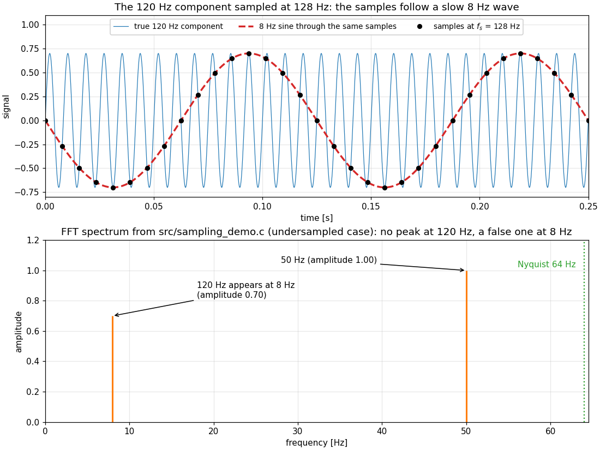
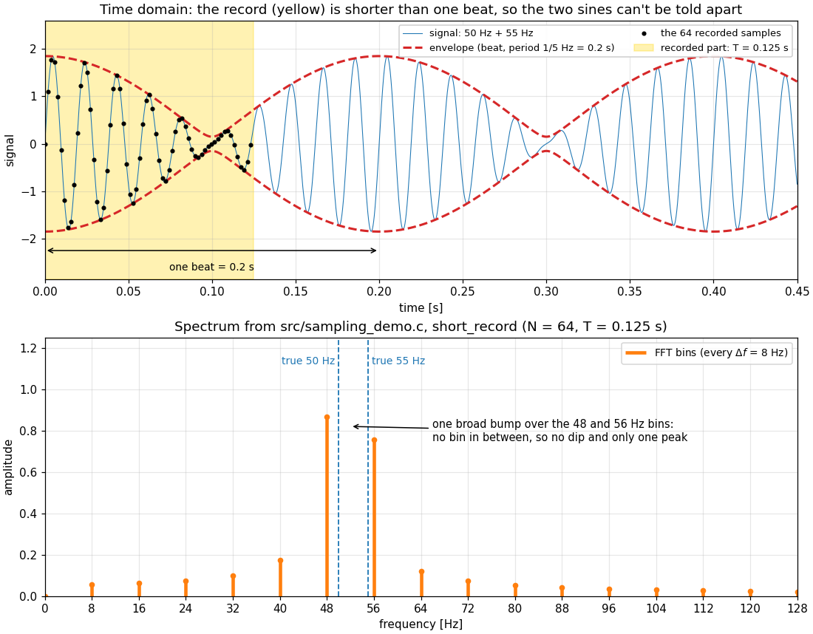

# HomeWork 04: Fourier Transform

Worksheet answers for the [myfft_tutorial](https://github.com/alexninogh/myfft_tutorial) project
([LESSONS.md](https://github.com/alexninogh/myfft_tutorial/blob/main/LESSONS.md)).

| File | Content |
|---|---|
| `README.md` | Answers to the worksheet (this file) |
| `ISSUES.md` | Errors found in the project, with the proposed solutions (opened as GitHub issues) |
| `images/` | Figures used in this README |
| `sampling_dft_fft/` | My own exercise: sampling, DFT vs FFT and aliasing in C (see its [README](sampling_dft_fft/README.md)) |

All the numbers below come from actually running the project (`make run`, GSL 2.7.1, gcc).

---

## Part 1: Before running anything

**1. What does an FFT tell you about a signal?**
It decomposes a *sampled* signal into sinusoids. For each frequency bin
fk = k·Δf it gives the amplitude (and phase) of the component at that frequency,
i.e. "how much" of each frequency is present in the data. The FFT is just a fast algorithm,
O(N log N) instead of O(N²), to compute the Discrete Fourier Transform (DFT).

**2. Sampling rate vs Nyquist frequency vs frequency resolution**

| Quantity | Formula | Meaning |
|---|---|---|
| Sampling rate | fs = 1/Δt | Samples per second |
| Nyquist frequency | fN = fs/2 | **Highest** frequency that can be represented: it sets the *range* of the spectrum |
| Frequency resolution | Δf = fs/N = 1/T | **Spacing** between FFT bins: it sets how close two frequencies can be and still be separated |

fN depends only on Δt; Δf depends only on the total duration T = N·Δt.

**3. Why is a uniform time grid important?**
The DFT assumes the samples are at tn = n·Δt with constant Δt. Only then does bin k
correspond to the physical frequency fk = k/(NΔt). With non-uniform samples the
frequency axis is meaningless. You either need different tools (e.g. Lomb–Scargle, non-uniform
FFT), or you first put the data on a uniform grid, which is what `coupled_oscillators_fft.c`
does with the ODE solver output.

---

## Part 2: Build and run

**1. CSV files created in `output/`:**
`good_sampling_signal.csv`, `good_sampling_spectrum.csv`, `undersampled_signal.csv`,
`undersampled_spectrum.csv`, `short_record_signal.csv`, `short_record_spectrum.csv`,
`coupled_oscillators_time.csv`, `coupled_oscillators_spectrum.csv`.

**2. Pure sampling issues:** `src/sampling_demo.c`.

**3. Mechanics problem:** `src/coupled_oscillators_fft.c`.

**4. Frequencies in the well-sampled case:** **50 Hz** (amplitude 1.0000) and **120 Hz**
(amplitude 0.7000), exactly the input amplitudes, because both frequencies fall exactly on a bin
(Δf = 1 Hz).

---

## Part 3: Sampling and aliasing (`undersampled`, fs = 128 Hz)

This part refers to the program **`src/sampling_demo.c`**, case `undersampled`: the signal
x(t) = sin(2π·50·t) + 0.7·sin(2π·120·t) sampled at fs = 128 Hz for 1 s.

**2. Nyquist frequency:** fN = 128 / 2 = **64 Hz**.

**3. Why 120 Hz can't be reconstructed:** 120 Hz > 64 Hz. With fewer than 2 samples per period,
the samples do not contain enough information to tell 120 Hz apart from a lower frequency.

**5. Why a high frequency appears as a false low frequency.**
- **Physically:** we only look at the wave 128 times per second. In the time between two
  samples, the 120 Hz wave goes through *almost* one full oscillation (120/128 = 0.94 of a
  period). So each new sample finds the wave almost where the previous one was, just slightly
  behind. Joining the samples we see a wave that moves slowly: the same as an 8 Hz wave.
  It is the same effect as the wheels of a car in a film, which can seem to turn slowly, or
  even backwards: the camera takes too few pictures per second to follow the real rotation.
- **Mathematically:** at the sampling times tn = n/fs,

  sin(2π·120·n/128) = sin(2π·(120 − 128)·n/128) = −sin(2π·8·n/128),

  because adding 2π·n to the argument doesn't change the sine. The **samples are identical** (up
  to the sign, i.e. a phase) to those of an 8 Hz sine, and the FFT only sees the samples. In
  general falias = |f − n·fs|: here |120 − 128| = **8 Hz**.

The program confirms it: peaks at 50 Hz (1.0000) and **8 Hz (0.7000)**. The 0.7 amplitude
of the 120 Hz component has moved entirely to 8 Hz, where there is no real signal.

- **Top:** only the 120 Hz component (blue). The black dots are the samples taken at 128 Hz:
  they don't follow the fast blue wave, but lie exactly on a slow 8 Hz wave (red, dashed).
- **Bottom:** the FFT spectrum computed by `src/sampling_demo.c`
  (`output/undersampled_spectrum.csv`). There is no peak at 120 Hz (it is above the Nyquist
  frequency, outside the plot); instead there is a false peak at 8 Hz with the same amplitude,
  0.70.

---

## Part 4: Frequency resolution (`short_record`, 50 Hz + 55 Hz)

This part refers to the program **`src/sampling_demo.c`**, case `short_record`: the signal
x(t) = sin(2π·50·t) + 0.85·sin(2π·55·t), sampled at fs = 512 Hz, but only
N = 64 samples are taken.

**2. Record length.** The samples are Δt = 1/fs = 1/512 s apart, so

T = N·Δt = 64 / 512 Hz = **0.125 s**.

**3. Bin spacing.** The FFT does not give a continuous spectrum: it gives the amplitude only on
a grid of frequencies 0, Δf, 2Δf, 3Δf, …, called **bins**, with

Δf = fs/N = 1/T = 512 / 64 = **8 Hz**.

So the FFT only "looks" at 0, 8, 16, …, 40, **48, 56**, 64, … Hz, and at nothing in between.
Why 1/T: the FFT describes the signal as a sum of oscillations that complete a *whole number*
of cycles in the record (1, 2, 3, … cycles in T). One cycle in 0.125 s is 8 Hz, two cycles is
16 Hz, and so on.

**4. Why the two frequencies are hard to separate.**
- **They are closer than one bin.** 50 and 55 Hz are 5 Hz apart, but the bins are 8 Hz
  apart. Both fall between the *same* two bins, 48 Hz and 56 Hz (50 Hz is at 6.25 bins, 55 Hz
  at 6.875 bins). There is no bin between them, so the spectrum cannot show a dip separating
  two peaks.
- **Leakage.** Neither frequency falls exactly on a bin, so the energy of each one spreads
  over the neighbouring bins (spectral leakage), which smears the spectrum further.
- **The time-domain view: beats.** Two sines 5 Hz apart produce a *beat*: the amplitude of the
  sum swells and fades with a period of 1/(55 − 50) = **0.2 s**. This slow beat is the only
  sign that there are two frequencies and not one. In 0.125 s we see less than one beat, so
  the signal looks like a single ~52 Hz sine whose amplitude changes a little. The information
  needed to separate the two frequencies is simply not in the data.

The program reports only **one peak, at 48 Hz** (amplitude 0.8651). The spectrum has tall bars
at 48 Hz (0.87) and 56 Hz (0.76), but no dip between them: one broad bump, not two resolved
peaks.

- **Top:** the signal over 0.45 s. The red dashed envelope is the beat (one period = 0.2 s);
  the yellow band is the only part that is recorded (0.125 s, the 64 black samples).
- **Bottom:** the spectrum computed by `src/sampling_demo.c` (`output/short_record_spectrum.csv`).
  The blue dashed lines are the true frequencies: both fall between the 48 and 56 Hz bins.

**Rule of thumb:** to separate two frequencies f1 and f2, the record must
be longer than 1/|f2 − f1|, here 1/5 Hz = 0.2 s (in practice a few times
longer, so that several bins lie between the peaks).

**5. What to change: the total acquisition time.** Δf = 1/T depends *only* on T.
- **The plotting tool** draws the numbers it receives: it cannot create bins that don't exist.
- **The file format** stores the same numbers in another way: it adds no information.
- A **higher sampling rate** would not help either: with the same T it gives more samples,
  but Δf = fs/N = 1/T stays 8 Hz. A higher fs only raises the Nyquist
  frequency, i.e. it shows *higher* frequencies, not *finer* ones.

Verified (Part 7, Option B): with N = 512 samples (T = 1 s, Δf = 1 Hz), 50 and 55 Hz fall
exactly on bins, 5 bins apart, and the program finds **50 Hz (1.0000) and 55 Hz (0.8500)**,
perfectly separated and without leakage.

Both spectra are computed by `src/sampling_demo.c`; the right one with N = 512 (the Option B
change). Same signal and same sampling rate: only the record length is different.

**In short:** the sampling rate fs decides the **highest** frequency we can see
(Nyquist, Part 3); the record length T decides **how close** two frequencies can be and still
be told apart (resolution, this part).

---

## Part 5: Coupled oscillators

**1. Equations of motion** (from `rhs()` in the code):

m ẍ1 = −(k + kc) x1 + kc x2

m ẍ2 = kc x1 − (k + kc) x2

with m = 1 kg, k = `wall_k` = 25 N/m, kc = `coupling_k` = 7 N/m.

**2. Physical system:** two identical masses, each connected to a wall by a spring k and to
each other by a coupling spring kc (wall – k – m – kc – m – k – wall).

**3. Normal modes:**
- **In-phase** (x1 = x2). The coupling spring is never stretched, so
  ω² = k/m and fin = √(k/m)/2π = **0.79577 Hz**.
- **Out-of-phase** (x1 = −x2). The coupling spring is stretched by
  2x, so ω² = (k + 2kc)/m and fout = √((k+2kc)/m)/2π =
  **0.99392 Hz**.

**4. Why x1(t) has more than one frequency:** the initial condition
x1 = 0.1, x2 = 0 is not a normal mode. It is a combination of both, with
equal weight:

(0.1, 0) = 0.05·(1, 1) + 0.05·(1, −1),

so x1(t) = 0.05 cos(ωint) + 0.05 cos(ωoutt). That gives two
peaks of amplitude ≈ 0.05 each (measured 0.0486 and 0.0462). In the time domain, this sum
shows up as beats: the energy goes back and forth between the two masses.

**5. Why compare with theory:** it validates the whole pipeline (equations, ODE solver,
sampling, FFT, frequency axis). If the peaks didn't match the analytic frequencies, something
in the model or the code would be wrong. It is the numerical equivalent of a calibration.

---

## Part 6: Plot inspection

**1. Aliasing:** the **undersampled spectrum** (`sampling_spectra.png`, middle panel). It
shows a strong peak at 8 Hz, where the input has no component.

(The time-domain plot `sampling_signals.png` doesn't really show it, because the 1 s window is
too dense to read. In the gnuplot version, half of the "good" samples are also dropped. See
[issue 3 in ISSUES.md](ISSUES.md).)

**2. Limited frequency resolution:** the **short-record spectrum** (bottom panel). 50 and 55 Hz
become one broad bump spread over the 8 Hz-wide bins, with leakage over the whole axis.

**3. Coupled oscillators:** yes, within one bin:

| Mode | Theory [Hz] | FFT peak [Hz] | Difference [Hz] |
|---|---|---|---|
| In-phase | 0.79577 | 0.79688 | +0.0011 |
| Out-of-phase | 0.99392 | 0.99219 | −0.0017 |

Bin spacing: Δf = 1/(1024 · 0.125 s) = 0.0078 Hz.

**4. Numerical reasons for the small differences:**
- **Discrete bins.** The FFT only has frequencies k·Δf, so the peak is the nearest bin. The
  error is at most Δf/2 = 0.0039 Hz, as observed.
- **Spectral leakage / scalloping.** The 128 s record doesn't contain an integer number of
  periods and no window is applied, so the energy spreads over nearby bins. The peak height is
  therefore lower than the true amplitude: 0.0486 and 0.0462 instead of 0.05.
- **ODE solver tolerance.** 10⁻⁹, so negligible here.
- **Improvement.** A longer record (smaller Δf), a window function (e.g. Hann), or
  interpolating between bins would all reduce the difference.

---

## Part 7: Small code modifications

All three options were tried.

### Option A: change the sampling rate (`undersampled`: fs 128 → 160 Hz, N = 128)

| | Prediction | Program output |
|---|---|---|
| Nyquist | 80 Hz | 80 Hz |
| Aliasing? | Yes: 120 Hz > 80 Hz | Yes |
| Peaks | 50 Hz, and the alias at \|120 − 160\| = 40 Hz | **50 Hz (1.0000), 40 Hz (0.7000)** |

The prediction is exactly confirmed. The alias moved from 8 Hz to 40 Hz: an alias's position
depends on fs, while a real signal's position does not.

### Option B: change the observation time (`short_record`: N 64 → 512, fs = 512 Hz)

| | Before | After |
|---|---|---|
| T | 0.125 s | 1 s |
| Δf = 1/T | 8 Hz | 1 Hz |
| Peaks found | 48 Hz only | **50 Hz (1.0000) and 55 Hz (0.8500)** |

The peaks are now perfectly distinct, and they also have the correct amplitudes, because both
frequencies fall exactly on a bin.

### Option C: change the spring constants (`coupling_k` 7 → 20 N/m)

| Mode | Prediction | FFT peak |
|---|---|---|
| In-phase | Unchanged: 0.79577 Hz (doesn't depend on kc) | 0.79688 Hz |
| Out-of-phase | √(25 + 40)/2π = 1.28315 Hz | 1.28125 Hz |

Both agree within one bin.

**Warning.** If kc is made large enough that fout > 4 Hz (the Nyquist
frequency with dt = 0.125 s), e.g. kc = 400, the program reads outside its arrays and
prints a wrong result. Also, the Python plot keeps showing the old theoretical lines.
See issues 1 and 2 in [ISSUES.md](ISSUES.md).

---

## Part 8: Reflection

1. **About FFTs.** An FFT shows the frequency content of the *samples*, not of the "true"
   signal. Sampling too slowly creates frequencies that don't exist (aliasing), and recording
   for too short a time merges frequencies that do exist (Δf = 1/T). The rate and the duration
   control two different things.
2. **About scientific software organization.** Separating `src/`, `include/`, `build/` and
   `output/`, putting reusable code (`fft_utils.c`) in its own module, and automating every step
   with a Makefile makes the whole analysis reproducible with one command.

   But parameters should be defined in one place only: the Python plot copied the spring
   constants from the C code, and silently went out of sync when they were changed.
3. **What I would improve.**
   - Fix the out-of-bounds read when a mode is above Nyquist.
   - Have the C program export the theoretical frequencies for the plots.
   - Apply a window function to reduce leakage.
   - Use GSL's real-input FFT (`gsl_fft_real_*`), which also works without a power of two.
