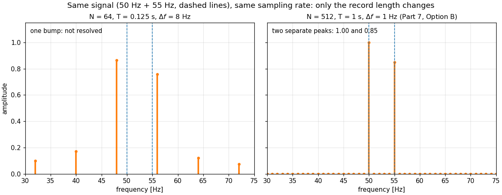
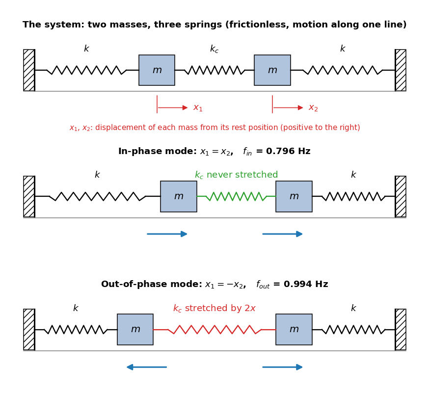
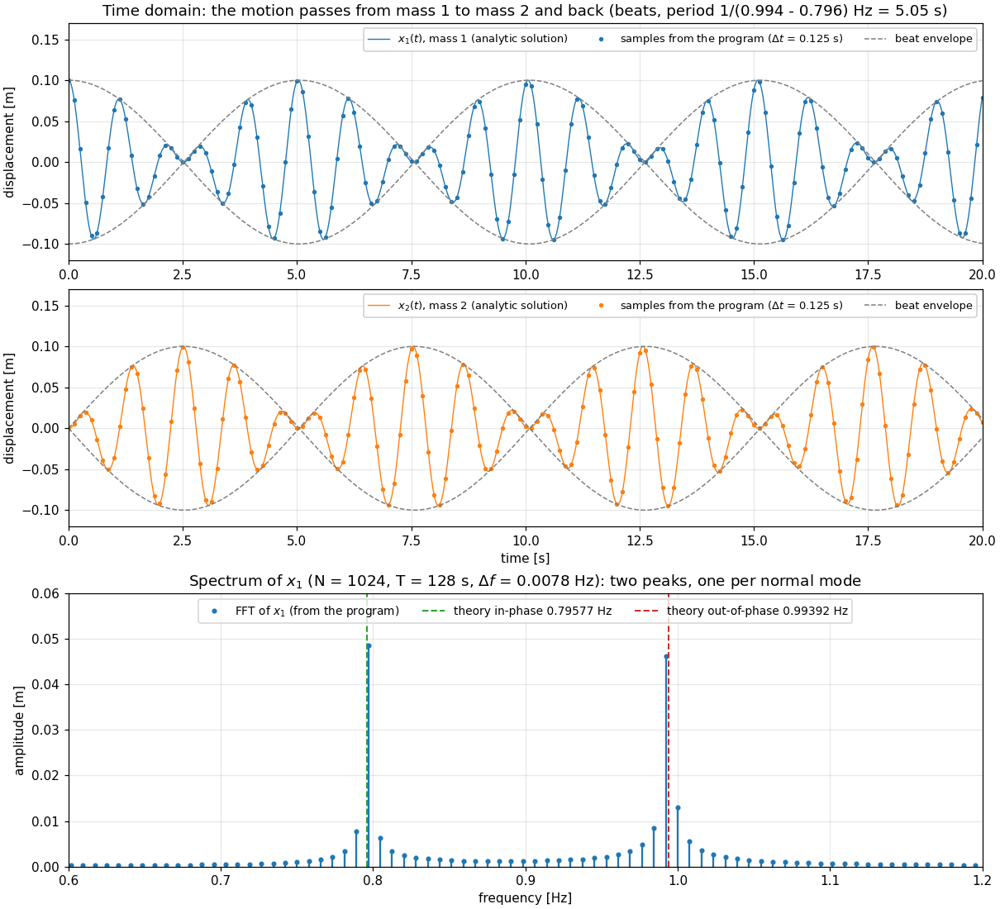
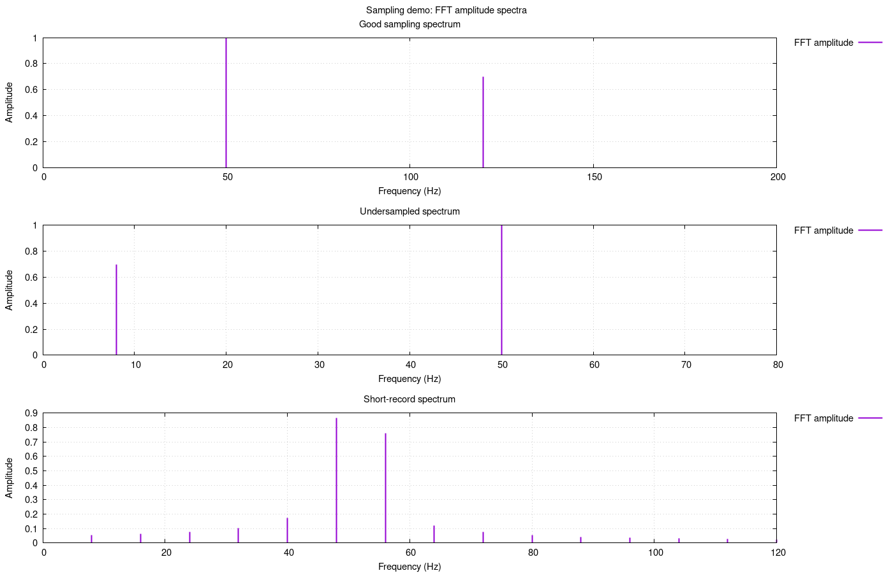
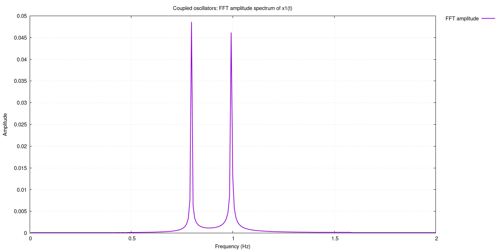
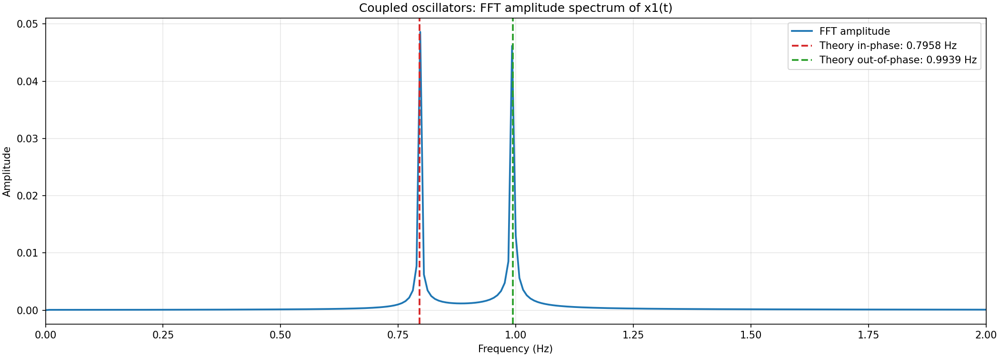

# HomeWork 04: Fourier Transform

Worksheet answers for the [myfft_tutorial](https://github.com/alexninogh/myfft_tutorial) project
([LESSONS.md](https://github.com/alexninogh/myfft_tutorial/blob/main/LESSONS.md)).

| File | Content |
|---|---|
| `README.md` | Answers to the worksheet (this file) |
| `ISSUES.md` | Errors found in the project, with the proposed solutions (opened as GitHub issues) |
| `images/` | Figures used in this README |

All the numbers below come from actually running the project (`make run`, GSL 2.7.1, gcc).

---

## Part 1: Before running anything

**1. What does an FFT tell you about a signal?**
It decomposes a *sampled* signal into sinusoids. For each frequency bin
$f_k = k \Delta f$ it gives the amplitude (and phase) of the component at that frequency,
i.e. "how much" of each frequency is present in the data. The FFT is just a fast algorithm,
$O(N \log N)$ instead of $O(N^2)$, to compute the Discrete Fourier Transform (DFT).

**2. Sampling rate vs Nyquist frequency vs frequency resolution**

| Quantity | Formula | Meaning |
|---|---|---|
| Sampling rate | $f_s = 1/\Delta t$ | Samples per second |
| Nyquist frequency | $f_N = f_s/2$ | **Highest** frequency that can be represented: it sets the *range* of the spectrum |
| Frequency resolution | $\Delta f = f_s/N = 1/T$ | **Spacing** between FFT bins: it sets how close two frequencies can be and still be separated |

$f_N$ depends only on $\Delta t$; $\Delta f$ depends only on the total duration $T = N \Delta t$.

**3. Why is a uniform time grid important?**
The DFT assumes the samples are at $t_n = n \Delta t$ with constant $\Delta t$. Only then does
bin $k$ correspond to the physical frequency $f_k = k/(N \Delta t)$. With non-uniform samples the
frequency axis is meaningless. You either need different tools (e.g. Lomb–Scargle, non-uniform
FFT), or you first put the data on a uniform grid, which is what `coupled_oscillators_fft.c`
does with the ODE solver output.

---

## Part 2: Build and run

**1. CSV files created in `output/`:**
`good_sampling_signal.csv`, `good_sampling_spectrum.csv`, `undersampled_signal.csv`,
`undersampled_spectrum.csv`, `short_record_signal.csv`, `short_record_spectrum.csv`,
`coupled_oscillators_time.csv`, `coupled_oscillators_spectrum.csv`.

**2. Pure sampling issues:** `src/sampling_demo.c`.

**3. Mechanics problem:** `src/coupled_oscillators_fft.c`.

**4. Frequencies in the well-sampled case:** **50 Hz** (amplitude 1.0000) and **120 Hz**
(amplitude 0.7000), exactly the input amplitudes, because both frequencies fall exactly on a bin
($\Delta f$ = 1 Hz).

---

## Part 3: Sampling and aliasing (`undersampled`, $f_s$ = 128 Hz)

This part refers to the program **`src/sampling_demo.c`**, case `undersampled`: the signal
$x(t) = \sin(2\pi \cdot 50 t) + 0.7 \sin(2\pi \cdot 120 t)$ sampled at $f_s$ = 128 Hz for 1 s.

**2. Nyquist frequency:** $f_N = 128/2$ = **64 Hz**.

**3. Why 120 Hz can't be reconstructed:** 120 Hz > 64 Hz. With fewer than 2 samples per period,
the samples do not contain enough information to tell 120 Hz apart from a lower frequency.

**5. Why a high frequency appears as a false low frequency.**
- **Physically:** we only look at the wave 128 times per second. In the time between two
  samples, the 120 Hz wave goes through *almost* one full oscillation (120/128 = 0.94 of a
  period). So each new sample finds the wave almost where the previous one was, just slightly
  behind. Joining the samples we see a wave that moves slowly: the same as an 8 Hz wave.
  It is the same effect as the wheels of a car in a film, which can seem to turn slowly, or
  even backwards: the camera takes too few pictures per second to follow the real rotation.
- **Mathematically:** at the sampling times $t_n = n/f_s$,

  $$\sin\left(2\pi \cdot 120 \frac{n}{128}\right) = \sin\left(2\pi (120 - 128) \frac{n}{128}\right) = -\sin\left(2\pi \cdot 8 \frac{n}{128}\right),$$

  because adding $2\pi n$ to the argument doesn't change the sine. The **samples are identical** (up
  to the sign, i.e. a phase) to those of an 8 Hz sine, and the FFT only sees the samples. In
  general $f_{\text{alias}} = \lvert f - n f_s \rvert$: here $\lvert 120 - 128 \rvert$ = **8 Hz**.

The program confirms it: peaks at 50 Hz (1.0000) and **8 Hz (0.7000)**. The 0.7 amplitude
of the 120 Hz component has moved entirely to 8 Hz, where there is no real signal.

*Figure 1 — `images/aliasing_120Hz.png` (made for this README from the output of `src/sampling_demo.c`, case `undersampled`).*

- **Top:** only the 120 Hz component (blue). The black dots are the samples taken at 128 Hz:
  they don't follow the fast blue wave, but lie exactly on a slow 8 Hz wave (red, dashed).
- **Bottom:** the FFT spectrum computed by `src/sampling_demo.c`
  (`output/undersampled_spectrum.csv`). There is no peak at 120 Hz (it is above the Nyquist
  frequency, outside the plot); instead there is a false peak at 8 Hz with the same amplitude,
  0.70.

---

## Part 4: Frequency resolution (`short_record`, 50 Hz + 55 Hz)

This part refers to the program **`src/sampling_demo.c`**, case `short_record`: the signal
$x(t) = \sin(2\pi \cdot 50 t) + 0.85 \sin(2\pi \cdot 55 t)$, sampled at $f_s$ = 512 Hz, but only
$N = 64$ samples are taken.

**2. Record length.** The samples are $\Delta t = 1/f_s$ = 1/512 s apart, so

$$T = N \Delta t = \frac{64}{512\ \text{Hz}} = 0.125\ \text{s}.$$

**3. Bin spacing.** The FFT does not give a continuous spectrum: it gives the amplitude only on
a grid of frequencies $0, \Delta f, 2\Delta f, 3\Delta f, \dots$, called **bins**, with

$$\Delta f = \frac{f_s}{N} = \frac{1}{T} = \frac{512}{64}\ \text{Hz} = 8\ \text{Hz}.$$

So the FFT only "looks" at 0, 8, 16, …, 40, **48, 56**, 64, … Hz, and at nothing in between.
Why $1/T$: the FFT describes the signal as a sum of oscillations that complete a *whole number*
of cycles in the record (1, 2, 3, … cycles in $T$). One cycle in 0.125 s is 8 Hz, two cycles is
16 Hz, and so on.

**4. Why the two frequencies are hard to separate.**
- **They are closer than one bin.** 50 and 55 Hz are 5 Hz apart, but the bins are 8 Hz
  apart. Both fall between the *same* two bins, 48 Hz and 56 Hz (50 Hz is at 6.25 bins, 55 Hz
  at 6.875 bins). There is no bin between them, so the spectrum cannot show a dip separating
  two peaks.
- **Leakage.** Neither frequency falls exactly on a bin, so the energy of each one spreads
  over the neighbouring bins (spectral leakage), which smears the spectrum further.
- **The time-domain view: beats.** Two sines 5 Hz apart produce a *beat*: the amplitude of the
  sum swells and fades with a period of $1/(55 - 50)$ = **0.2 s**. This slow beat is the only
  sign that there are two frequencies and not one. In 0.125 s we see less than one beat, so
  the signal looks like a single ~52 Hz sine whose amplitude changes a little. The information
  needed to separate the two frequencies is simply not in the data.

The program reports only **one peak, at 48 Hz** (amplitude 0.8651). The spectrum has tall bars
at 48 Hz (0.87) and 56 Hz (0.76), but no dip between them: one broad bump, not two resolved
peaks.

*Figure 2 — `images/resolution_short_record.png` (made for this README from the output of `src/sampling_demo.c`, case `short_record`, N = 64).*

- **Top:** the signal over 0.45 s. The red dashed envelope is the beat (one period = 0.2 s);
  the yellow band is the only part that is recorded (0.125 s, the 64 black samples).
- **Bottom:** the spectrum computed by `src/sampling_demo.c` (`output/short_record_spectrum.csv`).
  The blue dashed lines are the true frequencies: both fall between the 48 and 56 Hz bins.

**Rule of thumb:** to separate two frequencies $f_1$ and $f_2$, the record must
be longer than $1/\lvert f_2 - f_1 \rvert$, here 1/(5 Hz) = 0.2 s (in practice a few times
longer, so that several bins lie between the peaks).

**5. What to change: the total acquisition time.** $\Delta f = 1/T$ depends *only* on $T$.
- **The plotting tool** draws the numbers it receives: it cannot create bins that don't exist.
- **The file format** stores the same numbers in another way: it adds no information.
- A **higher sampling rate** would not help either: with the same $T$ it gives more samples,
  but $\Delta f = f_s/N = 1/T$ stays 8 Hz. A higher $f_s$ only raises the Nyquist
  frequency, i.e. it shows *higher* frequencies, not *finer* ones.

Verified (Part 7, Option B): with $N = 512$ samples ($T$ = 1 s, $\Delta f$ = 1 Hz), 50 and 55 Hz fall
exactly on bins, 5 bins apart, and the program finds **50 Hz (1.0000) and 55 Hz (0.8500)**,
perfectly separated and without leakage.

*Figure 3 — `images/resolution_longer_record.png` (made for this README: `src/sampling_demo.c` with N = 64, left, and N = 512, right).*

Both spectra are computed by `src/sampling_demo.c`; the right one with $N = 512$ (the Option B
change). Same signal and same sampling rate: only the record length is different.

**In short:** the sampling rate $f_s$ decides the **highest** frequency we can see
(Nyquist, Part 3); the record length $T$ decides **how close** two frequencies can be and still
be told apart (resolution, this part).

---

## Part 5: Coupled oscillators

This part refers to the program **`src/coupled_oscillators_fft.c`**. It:
1. integrates the equations of motion of two coupled oscillators with a GSL ODE solver
   (`rkf45`, a Runge–Kutta–Fehlberg method with adaptive step, tolerance 10⁻⁹);
2. stores the position $x_1(t)$ of the first mass on a uniform time grid:
   $\Delta t$ = 0.125 s, $N = 1024$ samples, so $T$ = 128 s;
3. computes the FFT of $x_1(t)$ and compares its peaks with the theoretical
   normal-mode frequencies.

With these values, the Nyquist frequency is $1/(2\Delta t)$ = 4 Hz and the bin spacing is
$\Delta f = 1/T$ = 0.0078 Hz, fine enough to resolve frequencies around 1 Hz.

**2. The physical system** (answered first, since it explains the equations).
Two identical masses $m$ slide without friction along a line. Each is attached to a fixed wall
by a spring of constant $k$, and the two masses are attached to each other by a *coupling*
spring of constant $k_c$:

wall – $k$ – $m$ – $k_c$ – $m$ – $k$ – wall

$x_1$ and $x_2$ are the displacements of the masses from their rest positions
(positive to the right). Values in the code: $m$ = 1 kg, $k$ = `wall_k` = 25 N/m,
$k_c$ = `coupling_k` = 7 N/m. At $t = 0$ the first mass is pulled 0.1 m to the right
and the second one is at rest: $x_1$ = 0.1 m, $x_2 = 0$, both velocities 0.

*Figure 4 — `images/coupled_system.png`: sketch of the system of `src/coupled_oscillators_fft.c` and of its two normal modes.*

**1. Equations of motion** (from `rhs()` in the code). On mass 1 act:
- the wall spring, stretched by $x_1$: force $-k x_1$;
- the coupling spring, stretched by $(x_2 - x_1)$: force $+k_c (x_2 - x_1)$.

Mass 2 is the mirror image. Newton's law gives

$$m \ddot{x}_1 = -k x_1 + k_c (x_2 - x_1) = -(k + k_c) x_1 + k_c x_2$$

$$m \ddot{x}_2 = -k x_2 - k_c (x_2 - x_1) = k_c x_1 - (k + k_c) x_2$$

The term $k_c x_2$ in the first equation (and $k_c x_1$ in the second) is the coupling: the motion of each mass depends on the other one. The code
rewrites the two second-order equations as four first-order ones, for
$y = (x_1, v_1, x_2, v_2)$, which is the form an ODE
solver needs.

**3. Normal modes.** A *normal mode* is a motion in which both masses oscillate at the **same
frequency**, with a fixed ratio between their amplitudes. Any motion of the system is a sum of
normal modes.

To find them, take the sum and the difference of the two equations of motion:

$$\text{sum:} \qquad m (\ddot{x}_1 + \ddot{x}_2) = -k (x_1 + x_2)$$

$$\text{difference:} \qquad m (\ddot{x}_1 - \ddot{x}_2) = -(k + 2k_c)(x_1 - x_2)$$

The coupling terms cancel: $q_+ = x_1 + x_2$ and $q_- = x_1 - x_2$ each obey the equation of a *single*, independent
harmonic oscillator. These are the two normal modes:

| | In-phase mode | Out-of-phase mode |
|---|---|---|
| Motion | $x_1 = x_2$: the masses move together, same direction | $x_1 = -x_2$: the masses move in opposite directions (towards each other, then apart) |
| Coupling spring | always the same length (never stretched), so it does nothing | stretched or compressed by $2x$, so it adds a restoring force $2k_c x$ |
| $\omega^2$ | $k/m$ = 25 s⁻² | $(k + 2k_c)/m$ = 39 s⁻² |
| $\omega$ | 5.000 rad/s | 6.245 rad/s |
| $f = \omega/2\pi$ | **0.79577 Hz** | **0.99392 Hz** |
| Period | 1.257 s | 1.006 s |

The out-of-phase mode is faster because the coupling spring adds to the restoring force.
Equivalently, in matrix form

$$m \ddot{\mathbf{x}} = -K \mathbf{x}, \qquad K = \begin{pmatrix} k + k_c & -k_c \cr -k_c & k + k_c \end{pmatrix}:$$

the normal modes are the eigenvectors $(1, 1)$ and $(1, -1)$ of $K$, and the eigenvalues $k$ and
$k + 2k_c$ give $m\omega^2$.

**4. Why $x_1(t)$ has more than one frequency.** The initial condition
$(x_1, x_2) = (0.1, 0)$ is *not* a normal mode: only one mass is pulled.
It is a combination of both modes, with equal weight:

$$(0.1, 0) = \underbrace{0.05 (1, 1)}_{\text{in-phase}} + \underbrace{0.05 (1, -1)}_{\text{out-of-phase}}$$

Each mode then oscillates at its own frequency (the velocities start at 0, so as cosines):

$$x_1(t) = 0.05 \cos(\omega_{\text{in}} t) + 0.05 \cos(\omega_{\text{out}} t)$$

$$x_2(t) = 0.05 \cos(\omega_{\text{in}} t) - 0.05 \cos(\omega_{\text{out}} t)$$

So $x_1(t)$ contains **two frequencies**, 0.796 Hz and 0.994 Hz, each with amplitude
0.05 m, and the FFT shows **two peaks**. The program measures:

| Mode | Theory | Measured peak | Amplitude (theory 0.05 m) |
|---|---|---|---|
| In-phase | 0.79577 Hz | 0.79688 Hz | 0.0486 m |
| Out-of-phase | 0.99392 Hz | 0.99219 Hz | 0.0462 m |

The measured frequencies differ from theory by less than one bin ($\Delta f$ = 0.0078 Hz): the FFT can
only return multiples of $\Delta f$. The amplitudes are a little below 0.05 m because the true
frequencies fall between two bins, so part of the energy leaks into the neighbouring bins
(spectral leakage, as in Part 4).

**In the time domain: beats.** Two close frequencies added together give beats:

$$x_1(t) = 0.1 \cos\left(\tfrac{1}{2} \Delta\omega\ t\right) \cos(\bar{\omega} t), \qquad \Delta\omega = \omega_{\text{out}} - \omega_{\text{in}}, \qquad \bar{\omega} = \frac{\omega_{\text{in}} + \omega_{\text{out}}}{2}.$$

The fast oscillation (≈ 0.9 Hz) is modulated by a slow envelope. Physically, the **energy
moves back and forth between the two masses**: at $t = 0$ only mass 1 moves; after
$1/(2(f_{\text{out}} - f_{\text{in}}))$ = 2.5 s mass 1 is almost still and mass 2 has all the
motion; after 5.05 s the motion is back on mass 1, and so on.

*Figure 5 — `images/coupled_results.png` (made for this README from the output of `src/coupled_oscillators_fft.c`).*

- **Top and middle:** $x_1(t)$ (mass 1) and $x_2(t)$ (mass 2), both
  centred on 0, on the same time axis. The dots are the samples written by the program
  (`output/coupled_oscillators_time.csv`), the lines are the analytic solution above, and the
  dashed grey lines are the beat envelopes. When the oscillation of mass 1 is large, mass 2 is
  almost still (t = 0, 5, 10 s), and vice versa (t = 2.5, 7.5 s).
- **Bottom:** the FFT of $x_1$ computed by the program
  (`output/coupled_oscillators_spectrum.csv`), with the two theoretical frequencies as dashed
  lines.

**5. Why compare with theory.** The program is a chain of steps: equations of motion → ODE
solver → sampling on a grid → FFT → frequency axis. An error in *any* step (a wrong sign in
`rhs()`, a solver that is not accurate enough, a wrong $\Delta t$ or frequency axis) would move the
peaks or create wrong ones. This system has an exact analytic solution, so we know where the
peaks must be: if the numerical peaks fall on the theoretical frequencies (within one bin), the
whole chain is validated at once. It is the numerical equivalent of calibrating an instrument
with a known source. Once validated, the same program can be trusted on systems with no
analytic solution (e.g. non-linear springs, more masses).

---

## Part 6: Plot inspection

The answers refer to the plots generated with **`make plot`** (gnuplot), run in the tutorial
folder without any modification. `make plot` first runs both programs (`make run`), then the
gnuplot scripts `scripts/plot_sampling.gp` and `scripts/plot_coupled_oscillators.gp`, which
write the figures in `plots/`. (`make plot-python` makes the same figures with matplotlib.)

**1. Aliasing:** the **undersampled spectrum**: `plots/sampling_spectra.png`, middle panel
(Figure 6).
It shows a strong peak at 8 Hz (amplitude 0.7), where the input has no component: it is the
120 Hz component, folded back below the Nyquist frequency of 64 Hz (see Part 3).

*Figure 6 — `plots/sampling_spectra.png`, made by `make plot`. For aliasing, look at the **middle** panel ("Undersampled spectrum").*

The other figure, the time-domain plot `plots/sampling_signals.png`, doesn't show it: over the
full 1 s the oscillations are so dense that the curves look like an unreadable zigzag, and the
slow 8 Hz oscillation can't be seen (see [issue 3 in ISSUES.md](ISSUES.md)).

**2. Limited frequency resolution:** the **short-record spectrum**:
`plots/sampling_spectra.png`, bottom panel (Figure 7). The bars are 8 Hz apart, so the frequency grid is
visibly coarse, and 50 and 55 Hz become one broad bump over the 48 and 56 Hz bins, with no dip
between them and with leakage spread over the whole axis (see Part 4).

*Figure 7 — `plots/sampling_spectra.png`, made by `make plot` (the same figure as Figure 6). For frequency resolution, look at the **bottom** panel ("Short-record spectrum").*

**3. Coupled oscillators:** `plots/coupled_oscillators_spectrum.png` (Figure 8). Yes, the two
peaks line up with the normal-mode frequencies within one bin:

*Figure 8 — `plots/coupled_oscillators_spectrum.png`, made by `make plot` (gnuplot version, without theoretical lines).*

Note: the gnuplot version of this plot has **no theoretical reference lines**. The Python
version, made with **`make plot-python`** (Figure 9), draws them as dashed lines, and shows
directly that each peak sits on its theoretical frequency:

*Figure 9 — `plots/coupled_oscillators_spectrum.png`, made by `make plot-python` (Python version, with the theoretical frequencies as dashed lines).*

(In the Python script these theoretical lines are computed from spring constants written again
inside the script, not read from the C program: with the default values they are correct, but
they would not follow a change of the constants in the C code. See
[issue 2 in ISSUES.md](ISSUES.md).)

The theoretical values used for the comparison are the ones printed by `coupled_oscillators_fft`
(and derived in Part 5):

| Mode | Theory [Hz] | FFT peak [Hz] | Difference [Hz] |
|---|---|---|---|
| In-phase | 0.79577 | 0.79688 | +0.0011 |
| Out-of-phase | 0.99392 | 0.99219 | −0.0017 |

Bin spacing: $\Delta f = 1/(N \Delta t)$ = 1/(1024 · 0.125 s) = 0.0078 Hz.

**4. Numerical reasons for the small differences:**
- **Discrete bins.** The FFT only has frequencies $k \Delta f$, so the peak is the nearest bin. The
  error is at most $\Delta f/2$ = 0.0039 Hz, as observed.
- **Spectral leakage / scalloping.** The 128 s record doesn't contain an integer number of
  periods and no window is applied, so the energy spreads over nearby bins: this is the width
  at the base of the two peaks in the plot. The peak height is therefore lower than the true
  amplitude: 0.0486 and 0.0462 instead of 0.05.
- **ODE solver tolerance.** 10⁻⁹, so negligible here.
- **Improvement.** A longer record (smaller $\Delta f$), a window function (e.g. Hann), or
  interpolating between bins would all reduce the difference.

---

## Part 7: Small code modifications

All three options were tried.

### Option A: change the sampling rate (`undersampled`: $f_s$ 128 → 160 Hz, $N = 128$)

| | Prediction | Program output |
|---|---|---|
| Nyquist | 80 Hz | 80 Hz |
| Aliasing? | Yes: 120 Hz > 80 Hz | Yes |
| Peaks | 50 Hz, and the alias at $\lvert 120 - 160 \rvert$ = 40 Hz | **50 Hz (1.0000), 40 Hz (0.7000)** |

The prediction is exactly confirmed. The alias moved from 8 Hz to 40 Hz: an alias's position
depends on $f_s$, while a real signal's position does not.

### Option B: change the observation time (`short_record`: $N$ 64 → 512, $f_s$ = 512 Hz)

| | Before | After |
|---|---|---|
| $T$ | 0.125 s | 1 s |
| $\Delta f = 1/T$ | 8 Hz | 1 Hz |
| Peaks found | 48 Hz only | **50 Hz (1.0000) and 55 Hz (0.8500)** |

The peaks are now perfectly distinct, and they also have the correct amplitudes, because both
frequencies fall exactly on a bin.

### Option C: change the spring constants (`coupling_k` 7 → 20 N/m)

| Mode | Prediction | FFT peak |
|---|---|---|
| In-phase | Unchanged: 0.79577 Hz (doesn't depend on $k_c$) | 0.79688 Hz |
| Out-of-phase | $\sqrt{25 + 40}/2\pi$ = 1.28315 Hz | 1.28125 Hz |

Both agree within one bin.

**Warning.** If $k_c$ is made large enough that $f_{\text{out}}$ > 4 Hz (the Nyquist
frequency with dt = 0.125 s), e.g. $k_c = 400$, the program reads outside its arrays and
prints a wrong result. Also, the Python plot keeps showing the old theoretical lines.
See issues 1 and 2 in [ISSUES.md](ISSUES.md).

---

## Part 8: Reflection

1. **About FFTs.** An FFT shows the frequency content of the *samples*, not of the "true"
   signal. Sampling too slowly creates frequencies that don't exist (aliasing), and recording
   for too short a time merges frequencies that do exist ($\Delta f = 1/T$). The rate and the duration
   control two different things.
2. **About scientific software organization.** Separating `src/`, `include/`, `build/` and
   `output/`, putting reusable code (`fft_utils.c`) in its own module, and automating every step
   with a Makefile makes the whole analysis reproducible with one command.

   But parameters should be defined in one place only: the Python plot copied the spring
   constants from the C code, and silently went out of sync when they were changed.
3. **What I would improve.**
   - Fix the out-of-bounds read when a mode is above Nyquist.
   - Have the C program export the theoretical frequencies for the plots.
   - Apply a window function to reduce leakage.
   - Use GSL's real-input FFT (`gsl_fft_real_*`), which also works without a power of two.
