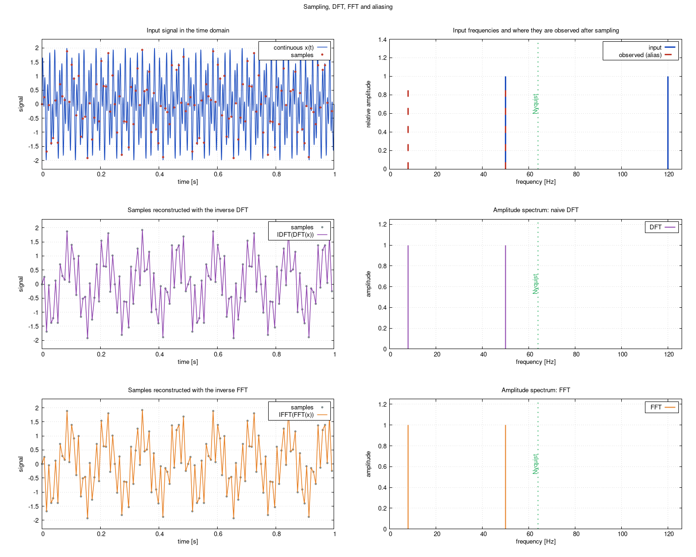
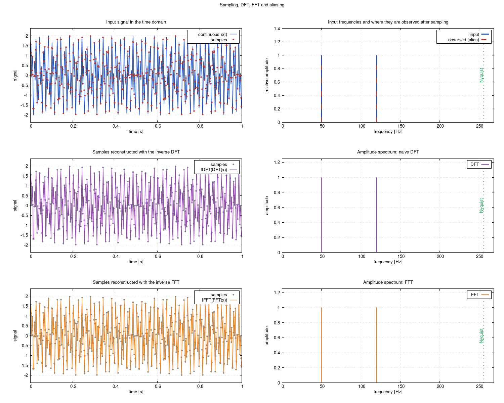
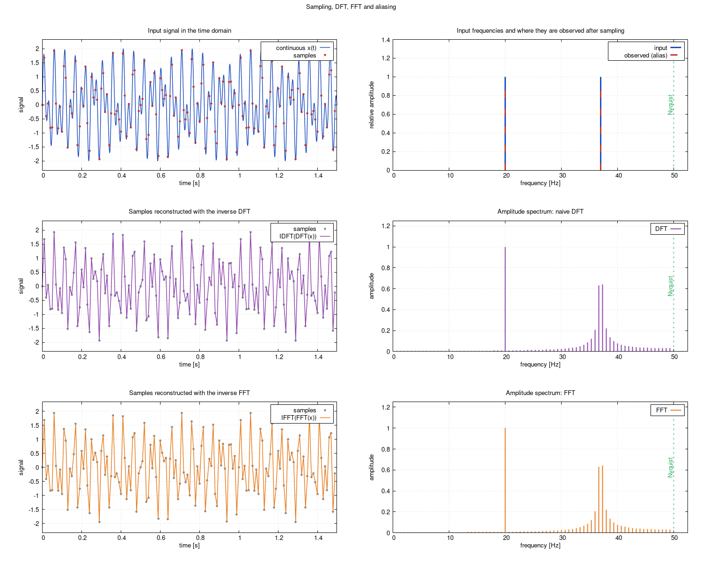
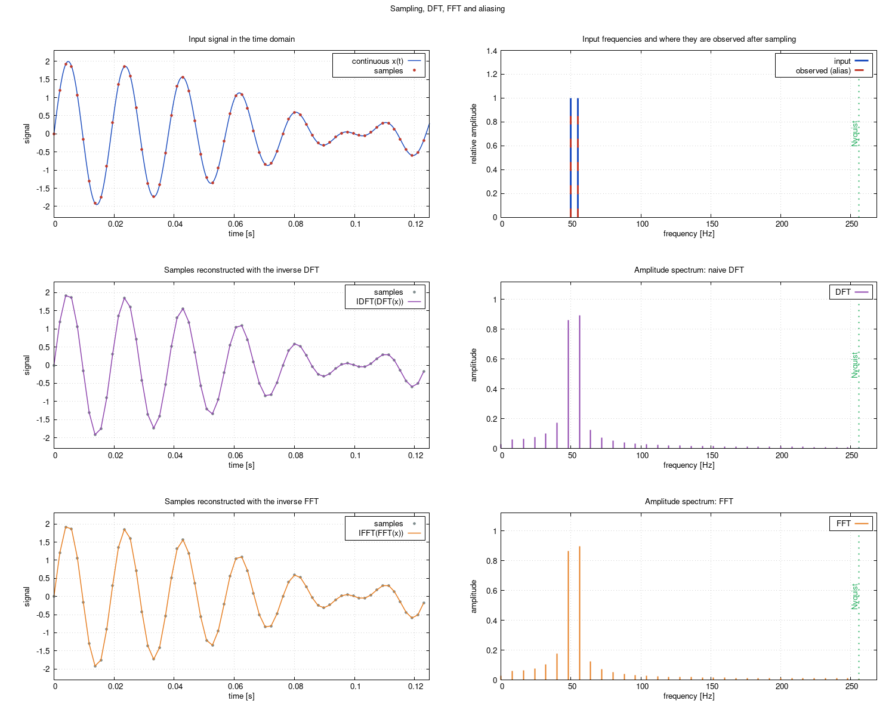

# Sampling, DFT, FFT and aliasing (C)

`sampling_dft_fft.c` samples the signal x(t) = Σ<sub>i</sub> sin(2π f<sub>i</sub> t) at
frequency f<sub>s</sub> for a time T (N = f<sub>s</sub>·T samples), then:

1. **predicts** where each input frequency is observed after sampling: its true frequency, an
   alias, or invisible;
2. **computes the spectrum** in two ways:
   - with a naive DFT, which costs O(N²) operations;
   - with an FFT, which costs O(N log N);
3. **reconstructs** the samples with the inverse transforms;
4. **times** both methods and **checks** that they agree;
5. **writes CSV files** in `output/`. `plot_sampling_dft_fft.gp` turns them into
   `plots/sampling_dft_fft.png`.

The FFT is a recursive *mixed-radix* Cooley–Tukey algorithm, so it works for **any N**, not only
powers of two.

| File | Content |
|---|---|
| `sampling_dft_fft.c` | The program (C version) |
| `plot_sampling_dft_fft.gp` | gnuplot script: 6-panel figure of the last run |
| `Makefile` | `make`, `make run`, `make plot`, `make help`, `make clean` |
| `images/` | The figures shown below (four example runs) |

## Build and run

```bash
make                                  # builds and prints the instructions
./sampling_dft_fft fs T f1 [f2 ...]
gnuplot plot_sampling_dft_fft.gp      # figure of the last run
```

| Argument | Meaning |
|---|---|
| `fs` | Sampling frequency [Hz] |
| `T` | Duration [s]. N = fs·T samples |
| `f1 f2 ...` | Frequencies [Hz] of the sines in the signal |

Examples:

| Command | What it shows |
|---|---|
| `./sampling_dft_fft 128 1 50 120` | 120 Hz is above Nyquist (64 Hz) and aliases to 8 Hz (`make plot` draws this one) |
| `./sampling_dft_fft 512 1 50 120` | Well sampled: peaks at 50 and 120 Hz |
| `./sampling_dft_fft 100 1.5 20 37` | N = 150 (not a power of two). 37 Hz is between two bins, so it leaks |
| `./sampling_dft_fft 128 1 64` | A sine exactly at Nyquist: every sample is 0, so the component is invisible |
| `./sampling_dft_fft 512 0.125 50 55` | Too short a record (Δf = 8 Hz): 50 and 55 Hz merge into one peak |
| `./sampling_dft_fft 97 1 10` | N = 97 is prime: the FFT can't split it, so it is no faster than the DFT |

Exit code: `0` OK, `1` wrong input / no memory / file error, `2` a check failed.

## Results: pictures

Each figure is made by `plot_sampling_dft_fft.gp` from one run of the program, and has 6 panels:

| Left column | Right column |
|---|---|
| the continuous signal and its samples | the input frequencies and where they are observed after sampling |
| the samples rebuilt with the inverse DFT | the amplitude spectrum from the naive DFT |
| the samples rebuilt with the inverse FFT | the amplitude spectrum from the FFT |

In every case the DFT and FFT spectra are identical, and the rebuilt samples match the original
ones.

### 1. Aliasing: `./sampling_dft_fft 128 1 50 120`

The sampling frequency is 128 Hz, so the Nyquist frequency is 64 Hz. The 50 Hz component is
below it and appears at 50 Hz. The 120 Hz component is above it, so the spectrum shows it at
|120 − 128| = **8 Hz**, a frequency that is not in the signal. In the top-left panel, the red
samples miss most of the fast oscillation.



### 2. Good sampling: `./sampling_dft_fft 512 1 50 120`

Same signal, but sampled at 512 Hz (Nyquist frequency 256 Hz). Both components are below the
Nyquist frequency, so the spectrum shows two clean peaks at their true frequencies, 50 and
120 Hz.



### 3. Leakage: `./sampling_dft_fft 100 1.5 20 37`

N = 150 samples (not a power of two: the mixed-radix FFT handles it). The bins are
Δf = 1/T = 0.67 Hz apart. 20 Hz is exactly on a bin and gives one sharp peak of height 1.
37 Hz falls between two bins (36.67 and 37.33 Hz): its energy **leaks** into the
neighbouring bins, and the two highest only reach about 0.64.



### 4. Record too short: `./sampling_dft_fft 512 0.125 50 55`

Only 0.125 s of signal, so Δf = 1/T = 8 Hz. The two frequencies are 5 Hz apart, less than
one bin: the spectrum shows a single wide bump over the 48 and 56 Hz bins, and the program
finds only one peak. The time-domain panel shows why: in 0.125 s the two sines don't have time
to drift apart, and we see only the start of a slow beat. To separate them, the record must be
longer than 1/(55 − 50) = 0.2 s.



## Results: DFT vs FFT timing (forward transform, this PC, `-O2`)

| N | Naive DFT | FFT | FFT faster by |
|---|---|---|---|
| 1 024 | 2.0 ms | 0.048 ms | 42× |
| 4 096 | 33 ms | 0.24 ms | 141× |
| 10 000 | 200 ms | 0.72 ms | 279× |
| 16 384 | 539 ms | 1.2 ms | 453× |
| 1 048 576 | (skipped, would take ~40 min) | 169 ms | |

Each time N is multiplied by 4, the DFT time grows by about 16× (N²), while the FFT time grows
by only about 5× (N log N). The DFT is skipped above N = 16 384.

In every run, DFT and FFT agree to ~10⁻¹², and the reconstructions match the samples to
~10⁻¹⁵.

## Things the program makes visible

- **Aliasing.** A component above f<sub>N</sub> = f<sub>s</sub>/2 appears at
  |f − n·f<sub>s</sub>| in [0, f<sub>N</sub>].
- **Invisible components.** A sine whose alias falls exactly on 0 Hz or on f<sub>N</sub> is
  sampled at its zeros. For example, at f = f<sub>N</sub>:
  sin(2π·f<sub>N</sub>·n/f<sub>s</sub>) = sin(π n) = 0. All its samples are 0, so it
  disappears completely; it does not turn into a DC component.
- **Leakage.** If a frequency is not a multiple of Δf = 1/T, its energy spreads over nearby
  bins, and the peak is lower than the true amplitude.
- **Speed depends on N's prime factors.** The FFT splits N into its prime factors:
  - 2<sup>k</sup> is fastest;
  - N = 150 = 2·3·5² is still fast;
  - a prime N cannot be split, so it costs as much as a DFT.
