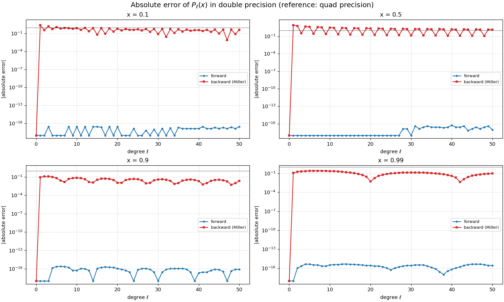

# HomeWork05: Stability of Legendre polynomials

## The assignment

For order $m = 0$ and degrees up to $\ell_{\max} = 50$, compare numerical ways of computing
the Legendre polynomials $P_\ell(x)$ (which are $Y_{\ell 0}$ up to normalization) at
$x = 0.1,\ 0.5,\ 0.9,\ 0.99$, and check whether the expected stability claim is actually true.
The three methods asked for:

1. **Direct three-term forward recurrence** (Bonnet): $P_0 = 1$, $P_1 = x$,

   $$P_{\ell+1}(x) = \frac{2\ell+1}{\ell+1} x P_\ell(x) - \frac{\ell}{\ell+1} P_{\ell-1}(x), \qquad \ell \ge 1.$$

2. **High-precision reference values**, treated as exact when measuring the double-precision
   errors.
3. **Backward recurrence experiment** (Miller style): solve the recurrence for $P_{\ell-1}$,

   $$P_{\ell-1}(x) = \frac{2\ell+1}{\ell} x P_\ell(x) - \frac{\ell+1}{\ell} P_{\ell+1}(x), \qquad \ell = L, L-1, \dots, 1,$$

   start from $\tilde P_{L+1} = 0$, $\tilde P_L = 1$, propagate backward, rescale with
   $c = 1/\tilde P_0$, $P_\ell^{(\text{back})} = c \tilde P_\ell$, and check whether this
   recovers $P_\ell(x)$.

List of actions: (1) implement the methods; (2) for $\ell = 0, \dots, 50$ compute absolute and
relative errors; (3) plot the relative error versus $\ell$ for each $x$, and inspect the
absolute error; (4) explain the numerical behaviour; (5) connect the result to the spherical
harmonics.

The sections below follow the list of actions.

| File | Content |
|---|---|
| `legendre_stability.c` | Computes the three methods and the errors, writes `output/legendre_P_x<value>.csv` |
| `plot_legendre.py` | Figures in `plots/` |
| `Makefile` | `make` (builds and prints the instructions), `make run`, `make plot`, `make help`, `make clean` |

## Build and run

```bash
make
./legendre_stability [l_max] [L] [x1 x2 ...]   # default: 50 80 0.1 0.5 0.9 0.99
make plot                                       # run + figures in plots/
```

## 1. The methods

| Method | How it is computed |
|---|---|
| **1. Forward** | Bonnet's recurrence upwards from $P_0 = 1$, $P_1 = x$, in `double` |
| **2. Reference** | The same forward recurrence in quad precision, `__float128` (113-bit mantissa, about 34 decimal digits) |
| **3. Backward (Miller style)** | $\tilde P_{L+1} = 0$, $\tilde P_L = 1$ with $L = 80$, the backward formula down to $\ell = 0$ in `double`, then $P_\ell^{(\text{back})} = \tilde P_\ell / \tilde P_0$ |

**The reference is reliable.**
- A quad-precision forward recurrence is "a high-precision implementation of the recurrence",
  as allowed by the assignment. With ~34 digits it is about 10¹⁸ times more precise than a
  `double`, so it can be treated as exact.
- It agrees with **exact rational arithmetic** (Python `fractions`) to 10⁻²⁷, the number of
  digits written in the CSV files.
- It uses exactly the same (rounded) $x$ as the double-precision code, so only the error of the
  *algorithm* is measured.
- GSL (`gsl_sf_legendre_Pl_array`) could **not** be the reference: it computes the same forward
  recurrence in `double`, so its values are bit-for-bit identical to ours (column "GSL =fw" in
  the program output) and the measured error would always be exactly 0.

## 2. Absolute and relative errors ($\ell = 0, \dots, 50$)

`make run` ($\ell_{\max} = 50$, $L = 80$). Largest error over $\ell = 0, \dots, 50$:

| $x$ | Forward: abs | Forward: rel | Backward: abs | Backward: rel |
|---|---|---|---|---|
| 0.1 | 2.8·10⁻¹⁷ | 6.9·10⁻¹⁵ | 2.5 | 2.8·10² |
| 0.5 | 5.6·10⁻¹⁷ | 8.1·10⁻¹⁶ | 7.9 | 4.7·10¹ |
| 0.9 | 2.5·10⁻¹⁶ | 5.6·10⁻¹⁵ | 0.12 | 1.6 |
| 0.99 | 4.7·10⁻¹⁶ | 1.1·10⁻¹⁴ | 0.25 | 2.9 |

- **Forward:** absolute errors ≤ 5·10⁻¹⁶ at every $x$, also close to 1 ($x = 0.99$). It stays
  accurate for much larger $\ell$ too: `./legendre_stability 1000 1500 0.99` gives 1.7·10⁻¹⁵ at
  $\ell = 1000$.
- **Backward:** errors of order 1 (relative errors from 1.6 to 280): the result is simply not
  $P_\ell(x)$. A larger starting point does not help: with $L = 200$ or $L = 1000$ the errors
  at $x = 0.5$ and $0.99$ are still between 0.2 and 15 (e.g. `./legendre_stability 50 1000 0.5`).
- **Why are the relative errors sometimes 10⁻¹⁴ when the absolute ones are 10⁻¹⁶?** Near a zero
  of $P_\ell(x)$, dividing by a tiny $P_\ell$ inflates the relative error, even when the
  absolute error is at the $\varepsilon$ level. That's why the absolute error must be inspected
  too.

## 3. Plots

`make plot` writes three figures in `plots/`:


`plots/legendre_P_relative_error.png`: relative error of $P_\ell(x)$ (absolute value) versus
$\ell$, one panel per $x$. Forward (blue) at the 10⁻¹⁶ level, backward (red) at 10⁻¹–10².



`plots/legendre_P_absolute_error.png`: absolute error of $P_\ell(x)$ versus $\ell$. The
forward error never exceeds a few times $\varepsilon$; the backward error is of order 0.1–10 for
every $\ell \ge 1$.


`plots/legendre_values.png`: the values themselves. The forward values lie on the reference;
the backward ones are a different oscillating sequence that only agrees with $P_\ell$ at
$\ell = 0$, where it is forced to by the rescaling.

## 4. Explanation of the numerical behaviour

**A three-term recurrence has two independent solutions.** Bonnet's recurrence is a
second-order difference equation, so its solutions form a two-dimensional space: every solution
is $a P_\ell(x) + b Q_\ell(x)$, where $Q_\ell$ is the Legendre function of the second kind. The
two starting values choose $a$ and $b$. In floating point every step adds a rounding error of
$\sim\varepsilon$, which is a small amount of *some* combination of both solutions. What happens
to it depends on how big the two solutions are compared with each other. For $\lvert x \rvert < 1$,
with $x = \cos\theta$:

$$P_\ell(\cos\theta) \approx \sqrt{\frac{2}{\pi \ell \sin\theta}} \cos\left(\left(\ell + \tfrac{1}{2}\right)\theta - \frac{\pi}{4}\right),$$

and $Q_\ell$ has the same form with a shifted phase: **both oscillate with the same amplitude
$\sim \ell^{-1/2}$**. Neither solution dominates the other.

**Miller's algorithm is useful when the wanted solution is minimal in the direction of
backward propagation.** If one solution is *minimal* (it decreases going up in $\ell$ while the
other grows), then going *down* in $\ell$ the wanted solution is the one that grows. Whatever the
arbitrary start ($\tilde P_L = 1$, $\tilde P_{L+1} = 0$), the backward recurrence quickly
forgets the unwanted part, and after enough steps only the wanted solution is left, up to a
constant that the rescaling $c = 1/\tilde P_0$ fixes.

**For $P_\ell(x)$ on $\lvert x \rvert < 1$ there is no dominant/minimal separation.** $P_\ell$ and
$Q_\ell$ have the same size, so nothing is suppressed in either direction. The backward
recurrence returns an arbitrary combination $a P_\ell + b Q_\ell$, fixed by the arbitrary start.
The rescaling with $c = 1/\tilde P_0$ fixes only one constant (the value at $\ell = 0$) and
cannot remove the $Q_\ell$ part, so the result is not $P_\ell$, however large $L$ is (section 2).

**Therefore the forward recurrence is stable.** For the same reason, going forward there is no
dominant solution to amplify the rounding errors: they stay at the $\varepsilon$ level and grow
only slowly, roughly $\propto \ell \varepsilon$. This is what the errors and the plots show.

**The backward errors are not rounding errors.** The errors of order 1 of the backward procedure
do not come from rounding errors that grow: even in exact arithmetic it would return the
combination $a P_\ell + b Q_\ell$ fixed by its arbitrary start, not $P_\ell$. It computes a
*different solution* of the recurrence.

## 5. Connection to spherical harmonics

For $m = 0$,

$$Y_{\ell 0}(\theta, \varphi) = \sqrt{\frac{2\ell+1}{4\pi}} P_\ell(\cos\theta),$$

so an error in $P_\ell(\cos\theta)$ goes directly into $Y_{\ell 0}$: the prefactor is a known
constant computed to full precision, and $Y_{\ell 0}$ has exactly the same *relative* error as
$P_\ell(\cos\theta)$.
- Building $Y_{\ell 0}$ with the **forward** recurrence, as is usually done, is safe:
  relative error ~10⁻¹⁶ away from the zeros.
- Building it with the **Miller-style backward** procedure would give completely wrong
  spherical harmonics: relative errors of 1–100 for $\ell \ge 1$.

## Conclusion

For $x = 0.1,\ 0.5,\ 0.9,\ 0.99$ and $\ell_{\max} = 50$:
- the ordinary Legendre **forward** recurrence is **stable** for all the tested cases, with
  absolute errors ≤ 5·10⁻¹⁶ against the high-precision reference;
- the arbitrary Miller-style **backward** procedure does **not** compute $P_\ell(x)$ for
  $\lvert x \rvert < 1$: its errors are of order 1, whatever the starting point $L$;
- **Miller's algorithm is useful only where the wanted solution is genuinely minimal**, which
  is not the case for $P_\ell(x)$ on $\lvert x \rvert < 1$, where $P_\ell$ and $Q_\ell$ have
  the same size.
