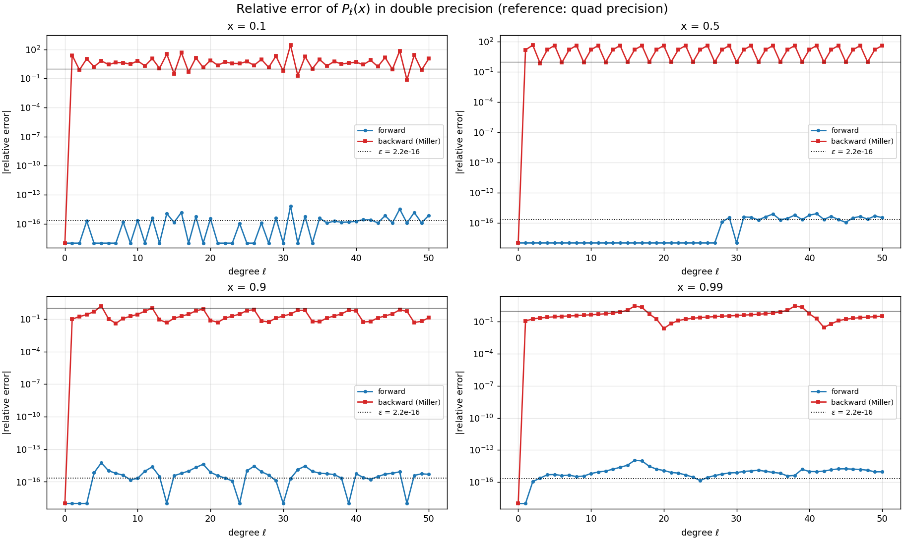

# HomeWork05: Stability of Legendre polynomials

## The assignment

For order m = 0 and degrees up to ℓ<sub>max</sub> = 50, compare numerical ways of computing
the Legendre polynomials P<sub>ℓ</sub>(x) (which are Y<sub>ℓ0</sub> up to normalization) at
**x = 0.1, 0.5, 0.9, 0.99**, and check whether the expected stability claim is actually true.
The three methods asked for:

1. **Direct three-term forward recurrence** (Bonnet):
   P<sub>0</sub> = 1, P<sub>1</sub> = x,
   P<sub>ℓ+1</sub>(x) = (2ℓ+1)/(ℓ+1) · x P<sub>ℓ</sub>(x) − ℓ/(ℓ+1) · P<sub>ℓ−1</sub>(x),  ℓ ≥ 1.
2. **High-precision reference values**, treated as exact when measuring the double-precision
   errors.
3. **Backward recurrence experiment** (Miller style): solve the recurrence for
   P<sub>ℓ−1</sub>,
   P<sub>ℓ−1</sub>(x) = (2ℓ+1)/ℓ · x P<sub>ℓ</sub>(x) − (ℓ+1)/ℓ · P<sub>ℓ+1</sub>(x),  ℓ = L, L−1, …, 1,
   start from P̃<sub>L+1</sub> = 0, P̃<sub>L</sub> = 1, propagate backward, rescale with
   c = 1/P̃<sub>0</sub>, P<sub>ℓ</sub><sup>(back)</sup> = c·P̃<sub>ℓ</sub>, and check whether this
   recovers P<sub>ℓ</sub>(x).

List of actions: (1) implement the methods; (2) for ℓ = 0 … 50 compute absolute and relative
errors; (3) plot the relative error versus ℓ for each x, and inspect the absolute error;
(4) explain the numerical behaviour; (5) connect the result to the spherical harmonics.

**Short answer.** The **forward** recurrence is stable for all the tested x (errors ~10⁻¹⁶,
also at x = 0.99); the Miller-style **backward** procedure does **not** recover
P<sub>ℓ</sub>(x) for |x| < 1 (errors of order 1, for every starting point L). Miller's
algorithm works only when the wanted solution is *minimal*, which is not the case here.

The sections below follow the list of actions. Sections marked **(additional)** go beyond the
assignment: they show *where* Miller's algorithm does work (the second solution
Q<sub>ℓ</sub>(x) at x > 1) and *how* a backward recurrence can recover P<sub>ℓ</sub> (two
normalization conditions instead of one).

| File | Content |
|---|---|
| `legendre_stability.c` | Computes all the methods and the errors, writes `output/legendre_<P\|Q>_x<value>.csv` |
| `plot_legendre.py` | Figures in `plots/` |
| `Makefile` | `make` (builds and prints the instructions), `make run`, `make plot`, `make help`, `make clean` |

## Build and run

```bash
make
./legendre_stability [l_max] [L] [x1 x2 ...]   # default: 50 80 0.1 0.5 0.9 0.99 1.1 1.5 3
make plot                                       # run + figures in plots/
```

For |x| < 1 the program studies P<sub>ℓ</sub>(x) (the assignment); for x > 1 it studies
Q<sub>ℓ</sub>(x) (additional, section 4).

## 1. The methods

| Method | How it is computed |
|---|---|
| **Forward** (assignment, 1) | Bonnet's recurrence upwards from P<sub>0</sub> = 1, P<sub>1</sub> = x, in `double` |
| **Reference** (assignment, 2) | The same forward recurrence in quad precision, `__float128` (113-bit mantissa, about 34 decimal digits) |
| **Backward, Miller** (assignment, 3) | P̃<sub>L+1</sub> = 0, P̃<sub>L</sub> = 1 with L = 80, the backward formula down to ℓ = 0 in `double`, then P<sub>ℓ</sub><sup>(back)</sup> = P̃<sub>ℓ</sub>/P̃<sub>0</sub> |
| Backward, two conditions (additional) | Two backward runs from independent starts (P̃<sub>L</sub> = 1, P̃<sub>L+1</sub> = 0 and P̃<sub>L</sub> = 0, P̃<sub>L+1</sub> = 1), combined so that P<sub>0</sub> = 1 **and** P<sub>1</sub> = x |
| Q<sub>ℓ</sub>(x), x > 1 (additional) | Same recurrence with Q<sub>0</sub> = ½ ln((x+1)/(x−1)), Q<sub>1</sub> = x Q<sub>0</sub> − 1: forward, and Miller normalized with Q<sub>0</sub>. Reference: Miller in quad precision from ℓ<sub>max</sub> + 1000 |

**The reference is reliable.**
- A quad-precision forward recurrence is "a high-precision implementation of the recurrence",
  as allowed by the assignment. With ~34 digits it is about 10¹⁸ times more precise than a
  `double`, so it can be treated as exact.
- It agrees with **exact rational arithmetic** (Python `fractions`) to 10⁻²⁷, the number of
  digits written in the CSV files. The Q<sub>ℓ</sub> reference agrees with a 120-digit
  computation to 10⁻³¹.
- It uses exactly the same (rounded) x as the double-precision code, so only the error of the
  *algorithm* is measured.
- GSL (`gsl_sf_legendre_Pl_array`) could **not** be the reference: it computes the same forward
  recurrence in `double`, so its values are bit-for-bit identical to ours (column "GSL =fw" in
  the program output) and the measured error would always be exactly 0.

## 2. Absolute and relative errors (ℓ = 0 … 50)

`make run` (ℓ<sub>max</sub> = 50, L = 80). Largest error over ℓ = 0 … 50:

| x | Forward: abs | Forward: rel | Miller backward: abs | Miller backward: rel | Two conditions (additional): abs |
|---|---|---|---|---|---|
| 0.1 | 2.8·10⁻¹⁷ | 6.9·10⁻¹⁵ | 2.5 | 2.8·10² | 2.2·10⁻¹⁶ |
| 0.5 | 5.6·10⁻¹⁷ | 8.1·10⁻¹⁶ | 7.9 | 4.7·10¹ | 8.3·10⁻¹⁷ |
| 0.9 | 2.5·10⁻¹⁶ | 5.6·10⁻¹⁵ | 0.12 | 1.6 | 5.0·10⁻¹⁶ |
| 0.99 | 4.7·10⁻¹⁶ | 1.1·10⁻¹⁴ | 0.25 | 2.9 | 4.4·10⁻¹⁵ |

- **Forward:** absolute errors ≤ 5·10⁻¹⁶ at every x, also close to 1 (x = 0.99). It stays
  accurate for much larger ℓ too: `./legendre_stability 1000 1500 0.99` gives 1.7·10⁻¹⁵ at
  ℓ = 1000.
- **Miller backward:** errors of order 1 (relative errors from 1.6 to 280): the result is
  simply not P<sub>ℓ</sub>(x). A larger starting point does not help: with L = 200 or
  L = 1000 the errors at x = 0.5 and 0.99 are still between 0.2 and 15.
- **Why are the relative errors sometimes 10⁻¹⁴ when the absolute ones are 10⁻¹⁶?** Near a zero
  of P<sub>ℓ</sub>(x), dividing by a tiny P<sub>ℓ</sub> inflates the relative error. This is a
  property of the *function* (its conditioning, section 4), not of the algorithm. That's why the
  assignment asks to inspect the absolute error too.

**(Additional) the second solution, Q<sub>ℓ</sub>(x) at x > 1:**

| x | Forward: abs | Forward: rel | Miller backward: abs | Miller backward: rel |
|---|---|---|---|---|
| 1.1 | 8.5·10⁻¹⁰ | **17** | 2.8·10⁻¹⁷ | 1.1·10⁻¹² |
| 1.5 | 6.3·10³ | **4.9·10²⁵** | 1.1·10⁻¹⁶ | 1.5·10⁻¹⁵ |
| 3 | 4.7·10²⁰ | **2.1·10⁶⁰** | 2.7·10⁻²⁰ | 4.6·10⁻¹⁶ |

Here the roles are exchanged: the forward recurrence explodes and Miller's backward recurrence
is accurate.

## 3. Relative error vs ℓ (plots)

`make plot` writes three figures in `plots/`:



*`plots/legendre_P_relative_error.png`: |relative error| of P<sub>ℓ</sub>(x), one panel per x.
Forward (blue) at the 10⁻¹⁶ level, Miller backward (red) at 10⁻¹–10², two conditions (green,
additional) at the 10⁻¹⁶ level. The dashed grey line κ<sub>ℓ</sub>(x)·ε is the error caused just
by rounding x itself (conditioning, section 4).*


*`plots/legendre_Q_relative_error.png` (additional): |relative error| of Q<sub>ℓ</sub>(x),
x > 1. The forward error grows as a straight line on the log scale (exponentially), Miller
stays at 10⁻¹⁵.*


*`plots/legendre_values.png`: the values themselves. Miller's P<sub>ℓ</sub> is visibly
different from the reference; the forward Q<sub>ℓ</sub> leaves the reference and grows.*

## 4. Explanation of the numerical behaviour

**A three-term recurrence has two independent solutions.** Bonnet's recurrence is a
second-order difference equation, so its solutions form a two-dimensional space: every solution
is a·P<sub>ℓ</sub>(x) + b·Q<sub>ℓ</sub>(x), where Q<sub>ℓ</sub> is the Legendre function of
the second kind. The two starting values choose a and b. In floating point every step adds a
rounding error of ~ε, which is a small amount of *some* combination of both solutions. What
happens to it depends on how big the two solutions are compared with each other:

| Region | P<sub>ℓ</sub> | Q<sub>ℓ</sub> | Dominant / minimal? |
|---|---|---|---|
| \|x\| < 1, x = cos θ | ≈ √(2/(πℓ sin θ)) cos((ℓ+½)θ − π/4) | similar amplitude, phase shifted | **neither**: both oscillate with amplitude ~ℓ<sup>−1/2</sup> |
| x > 1 | ~ λ<sup>ℓ</sup>/√ℓ, grows | ~ λ<sup>−ℓ</sup>/√ℓ, decays | P<sub>ℓ</sub> dominant, Q<sub>ℓ</sub> **minimal** |

where λ = x + √(x²−1) > 1.

**Miller's algorithm is useful when the wanted solution is minimal in the direction of
backward propagation.** Going *down* in ℓ, the solution that is minimal going up becomes the one
that grows. Whatever the arbitrary start (P̃<sub>L</sub> = 1, P̃<sub>L+1</sub> = 0), the
backward recurrence then quickly forgets the unwanted part, and after enough steps only the
wanted solution is left, up to a constant fixed by the normalization c = 1/P̃<sub>0</sub>.

**For P<sub>ℓ</sub>(x) on |x| < 1 there is no dominant/minimal separation.** P<sub>ℓ</sub> and
Q<sub>ℓ</sub> have the same size, so nothing is suppressed in either direction. The backward
recurrence returns an arbitrary combination a·P<sub>ℓ</sub> + b·Q<sub>ℓ</sub>, fixed by the
arbitrary start. The rescaling with c = 1/P̃<sub>0</sub> fixes one constant (the value at
ℓ = 0) but cannot remove the Q<sub>ℓ</sub> part, so the result is not P<sub>ℓ</sub>, however
large L is (section 2).

**Therefore the forward recurrence is stable.** For the same reason, going forward there is
no dominant solution to amplify the rounding errors: they stay at the ε level and grow only
slowly, roughly ∝ ℓ·ε. This is what the errors and the plots show.

**Conditioning vs stability.**
- **Conditioning** is a property of the *mathematical problem*: how much P<sub>ℓ</sub>(x)
  changes when x changes. The relative condition number is
  κ<sub>ℓ</sub>(x) = |x P′<sub>ℓ</sub>(x) / P<sub>ℓ</sub>(x)|. Here κ is moderate (median over
  ℓ ≤ 50 between 2 and 142 for the four x values; exactly at x = 1, κ = ℓ(ℓ+1)/2 ≈ 1275 at
  ℓ = 50). It is large only near the zeros of P<sub>ℓ</sub>, where no method can give a small
  *relative* error.
- **Stability** is a property of the *algorithm*: whether it adds more error than the
  conditioning makes unavoidable. The forward recurrence stays at the κ·ε level (the dashed line
  in the plot; the forward error is above it only at a few points, at most ×20, where κ is
  accidentally almost 0 near the maxima of P<sub>ℓ</sub>), and does not grow with ℓ: it is
  **stable**.

**(Additional) where Miller's algorithm does work: Q<sub>ℓ</sub>(x) at x > 1.** Here
Q<sub>ℓ</sub> is the minimal solution:
- **Forward, it is unstable.** A rounding error of size ε·Q<sub>ℓ</sub> containing a bit of
  P<sub>ℓ</sub> grows like λ<sup>2ℓ</sup> *relative to* Q<sub>ℓ</sub>, so the relative error is
  ≈ ε·λ<sup>2ℓ</sup>. This predicts 1.4·10²⁶ at x = 1.5 and 8·10⁶⁰ at x = 3, against the
  measured 4.9·10²⁵ and 2.1·10⁶⁰. This happens even though Q<sub>ℓ</sub>(x) is a perfectly
  well-conditioned, smoothly decaying function: a well-conditioned problem ruined by an unstable
  algorithm.
- **Backward (Miller), it is stable.** The P<sub>ℓ</sub> part dies out like
  λ<sup>−2(L−ℓ)</sup>. At x = 1.1 (λ = 1.56) with L = 80, the leftover at ℓ = 50 is
  ≈ λ<sup>−60</sup> = 3·10⁻¹² (measured 1.1·10⁻¹²); with L = 200 it disappears (10⁻¹⁵,
  `./legendre_stability 50 200 1.1`). The closer x is to 1, the larger L must be.
- For P<sub>ℓ</sub> at x > 1 the forward recurrence is fine, because P<sub>ℓ</sub> is itself
  the dominant solution.

**(Additional) how a backward recurrence can recover P<sub>ℓ</sub> at |x| < 1: two
conditions.** Since every solution is a·P<sub>ℓ</sub> + b·Q<sub>ℓ</sub>, *two* conditions fix
both constants. Two backward runs from independent starts give two independent solutions
A<sub>ℓ</sub> and B<sub>ℓ</sub>; the combination c<sub>a</sub>A<sub>ℓ</sub> + c<sub>b</sub>B<sub>ℓ</sub>
with value 1 at ℓ = 0 **and** x at ℓ = 1 is exactly P<sub>ℓ</sub>. For |x| < 1 the backward
recurrence itself is as stable as the forward one, so the result is accurate (errors
≤ 4·10⁻¹⁵); only Miller's single normalization was insufficient. For x > 1 this fails: both
backward runs are dominated by Q<sub>ℓ</sub>, they become proportional to all 16 digits, and
the 2×2 system for c<sub>a</sub>, c<sub>b</sub> is singular (its determinant is exactly 0 in
double precision for x = 1.1 and x = 3). In practice it has no advantage over the forward
recurrence, which needs one run instead of two.

## 5. Connection to spherical harmonics

For m = 0,

  Y<sub>ℓ0</sub>(θ, φ) = √((2ℓ+1)/(4π)) · P<sub>ℓ</sub>(cos θ),

so an error in P<sub>ℓ</sub>(cos θ) goes directly into Y<sub>ℓ0</sub>: the prefactor is a
known constant computed to full precision, and Y<sub>ℓ0</sub> has exactly the same *relative*
error as P<sub>ℓ</sub>(cos θ).
- Building Y<sub>ℓ0</sub> with the **forward** recurrence, as is usually done, is safe:
  relative error ~10⁻¹⁶ away from the zeros.
- Building it with the **Miller-style backward** procedure would give completely wrong
  spherical harmonics: relative errors of 1–100 for ℓ ≥ 1.

## Conclusion

For x = 0.1, 0.5, 0.9, 0.99 and ℓ<sub>max</sub> = 50:
- the ordinary Legendre **forward** recurrence is **stable** for all the tested cases, with
  absolute errors ≤ 5·10⁻¹⁶ against the high-precision reference;
- the arbitrary Miller-style **backward** procedure does **not** compute P<sub>ℓ</sub>(x) for
  |x| < 1: its errors are of order 1, whatever the starting point L;
- **Miller's algorithm is useful only where the wanted solution is genuinely minimal**, as for
  Q<sub>ℓ</sub>(x) at x > 1 (additional test), where it is accurate to 10⁻¹⁵ while the forward
  recurrence fails by up to 10⁶⁰.
