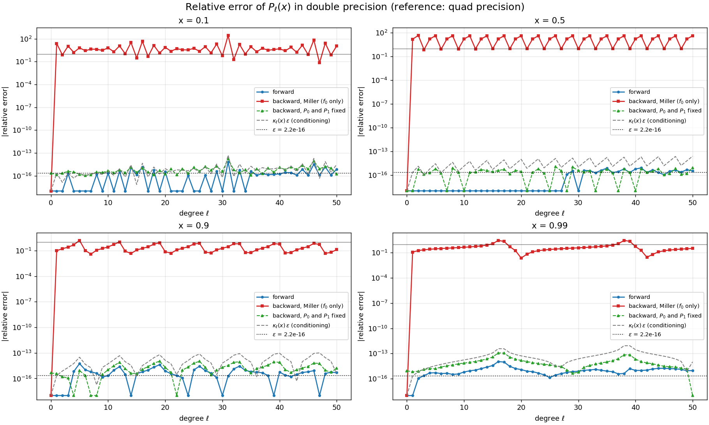
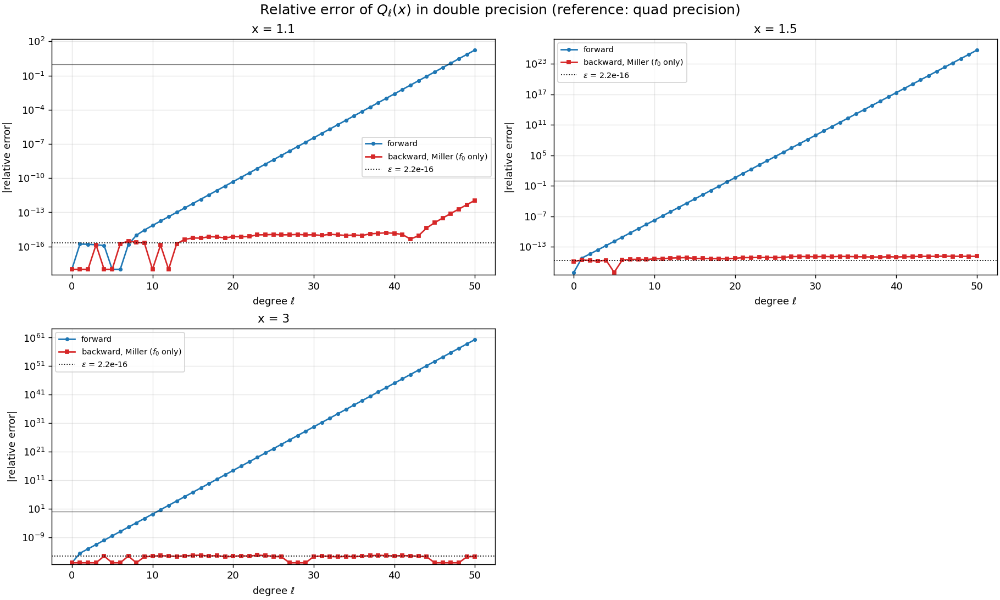
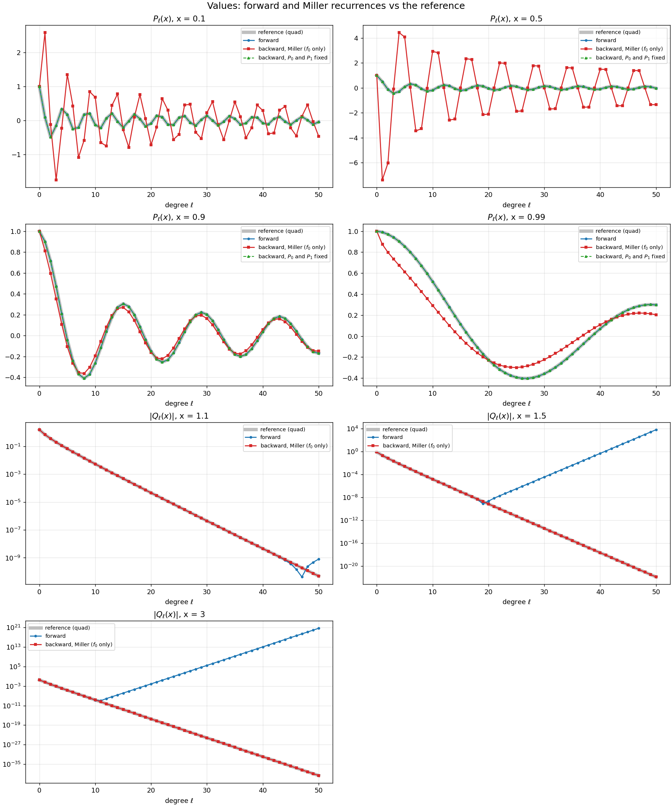

# Stability of the Legendre recurrence

HomeWork05 asks to compute P<sub>ℓ</sub>(x), ℓ = 0 … 50, with the three-term recurrence
- forward (ℓ increasing),
- backward with Miller's algorithm (from L = 80, normalized with P<sub>0</sub> = 1),

and to compare both with high-precision reference values at x = 0.1, 0.5, 0.9, 0.99.

> **Note: the HomeWork05 text contained an error, now confirmed by the professor.**
> In lecture 8 the professor wrote: *"The text in HW05 is wrong → I mixed up the forward and
> backward recurrence"*. The professor's
> ["starting solution"](https://codimd.infn.it/s/ftKB8jdK1) and the corrected example program
> shown in lecture 8 reach the same conclusion as this solution.

**What the original text claimed, and what is true.**
- *Claimed:* the forward recurrence becomes unstable near x = 1, and Miller's backward
  recurrence fixes it.
- *True for P<sub>ℓ</sub>, |x| < 1:* the **forward** recurrence is accurate to ~10⁻¹⁶. Miller's
  backward recurrence, normalized only with P<sub>0</sub> = 1, gives wrong results (errors of
  order 1).
- *Where the original claim does hold:* the "dominant/minimal solution" story (forward
  unstable, Miller as the fix) is real, but for the **other** solution of the same recurrence,
  **Q<sub>ℓ</sub>(x)**, at **x > 1**.

**The corrected version of the backward experiment.** The professor's corrected example
normalizes the backward recurrence with **two** conditions, P<sub>0</sub> = 1 *and*
P<sub>1</sub> = x, instead of P<sub>0</sub> = 1 only. With that change, the backward recurrence
gives accurate P<sub>ℓ</sub> for |x| < 1 (errors ≤ 4·10⁻¹⁵). This solution includes it as a
third method, and section 6 explains why it works.

| File | Content |
|---|---|
| `legendre_stability.c` | Computes, compares, writes `output/legendre_<P\|Q>_x<value>.csv` |
| `plot_legendre.py` | Figures in `plots/` |
| `Makefile` | `make` (builds and prints the instructions), `make run`, `make plot`, `make help`, `make clean` |

## Build and run

```bash
make
./legendre_stability [l_max] [L] [x1 x2 ...]   # default: 50 80 0.1 0.5 0.9 0.99 1.1 1.5 3
make plot                                       # run + figures in plots/
```

For |x| < 1 the program studies P<sub>ℓ</sub>(x); for x > 1 it studies Q<sub>ℓ</sub>(x).

## 1. The three methods

All three use the recurrence (ℓ+1) f<sub>ℓ+1</sub> = (2ℓ+1) x f<sub>ℓ</sub> − ℓ f<sub>ℓ−1</sub>.
The starting values select which solution you get:

| Function | Starting values |
|---|---|
| P<sub>ℓ</sub> | P<sub>0</sub> = 1, P<sub>1</sub> = x |
| Q<sub>ℓ</sub> (x > 1) | Q<sub>0</sub> = ½ ln((x+1)/(x−1)), Q<sub>1</sub> = x Q<sub>0</sub> − 1 |

| Method | How |
|---|---|
| Forward | Recurrence upwards in `double` |
| Miller backward (one condition, as in the original text) | f̃<sub>L+1</sub> = 0, f̃<sub>L</sub> = 1, recurrence downwards in `double`, then rescale so that f<sub>0</sub> = P<sub>0</sub> (or Q<sub>0</sub>) |
| Backward with two conditions (P<sub>ℓ</sub> only, as in the professor's correction) | Two backward runs from independent starts (f̃<sub>L</sub> = 1, f̃<sub>L+1</sub> = 0 and f̃<sub>L</sub> = 0, f̃<sub>L+1</sub> = 1), combined so that P<sub>0</sub> = 1 and P<sub>1</sub> = x |
| **Reference** | `__float128` (113-bit mantissa, ~34 digits). For P<sub>ℓ</sub>: forward recurrence. For Q<sub>ℓ</sub>: Miller from ℓ<sub>max</sub> + 1000 |

**Checking the references.**
- The P<sub>ℓ</sub> reference agrees with **exact rational arithmetic** (Python `fractions`)
  to 10⁻²⁷, which is the number of digits written in the CSV.
- The Q<sub>ℓ</sub> reference agrees with a 120-digit computation to 10⁻³¹.
- The reference uses exactly the same (rounded) x as the double-precision code, so only the
  *algorithm's* error is measured.

**Why not GSL as the reference?** `gsl_sf_legendre_Pl_array` computes the same forward
recurrence in double precision, so its values are **bit-for-bit identical** to ours (column
"GSL =fw" in the program output). Measuring the error against GSL always gives exactly 0. That
was the problem with the first version of this exercise.

## 2–3. Errors (`make run`, l<sub>max</sub> = 50, L = 80)

Largest error over ℓ = 0 … 50:

| Function | Forward: abs | Forward: rel | Miller (one condition): abs | Miller: rel | Backward, P<sub>0</sub> + P<sub>1</sub>: abs |
|---|---|---|---|---|---|
| P<sub>ℓ</sub>(0.1) | 2.8·10⁻¹⁷ | 6.9·10⁻¹⁵ | 2.5 | 2.8·10² | 2.2·10⁻¹⁶ |
| P<sub>ℓ</sub>(0.5) | 5.6·10⁻¹⁷ | 8.1·10⁻¹⁶ | 7.9 | 4.7·10¹ | 8.3·10⁻¹⁷ |
| P<sub>ℓ</sub>(0.9) | 2.5·10⁻¹⁶ | 5.6·10⁻¹⁵ | 0.12 | 1.6 | 5.0·10⁻¹⁶ |
| P<sub>ℓ</sub>(0.99) | 4.7·10⁻¹⁶ | 1.1·10⁻¹⁴ | 0.25 | 2.9 | 4.4·10⁻¹⁵ |
| Q<sub>ℓ</sub>(1.1) | 8.5·10⁻¹⁰ | **17** | 2.8·10⁻¹⁷ | 1.1·10⁻¹² | – |
| Q<sub>ℓ</sub>(1.5) | 6.3·10³ | **4.9·10²⁵** | 1.1·10⁻¹⁶ | 1.5·10⁻¹⁵ | – |
| Q<sub>ℓ</sub>(3) | 4.7·10²⁰ | **2.1·10⁶⁰** | 2.7·10⁻²⁰ | 4.6·10⁻¹⁶ | – |

| Claim in the original HomeWork05 text (acknowledged as wrong by the professor) | Result |
|---|---|
| Forward accurate far from 1 (x = 0.1) | $\color{green}{\textbf{O}}$ yes, ~10⁻¹⁶ |
| Forward unstable close to 1 (x = 0.99), errors of order 1 | $\color{red}{\textbf{X}}$ no: absolute error ≤ 5·10⁻¹⁶. Still accurate at ℓ = 1000 (`./legendre_stability 1000 1500 0.99`: 1.7·10⁻¹⁵) |
| Backward (Miller) accurate for all ℓ and x | $\color{red}{\textbf{X}}$ no: errors of order 1 for P<sub>ℓ</sub> at every x < 1 |
| *(same claims for Q<sub>ℓ</sub>, x > 1)* | $\color{green}{\textbf{O}}$ forward blows up, Miller accurate |
| *(corrected version)* Backward with P<sub>0</sub> and P<sub>1</sub> fixed, \|x\| < 1 | $\color{green}{\textbf{O}}$ accurate, errors ≤ 4·10⁻¹⁵, at the conditioning level like the forward recurrence |

**Why are the relative errors of P<sub>ℓ</sub> sometimes 10⁻¹⁴ when the absolute ones are
10⁻¹⁶?** Near a zero of P<sub>ℓ</sub>(x), dividing by a tiny P<sub>ℓ</sub> inflates the
relative error. This is a property of the *function* (conditioning, section 6), not of the
algorithm. The dashed line κ<sub>ℓ</sub>(x)·ε in the plot is the error you would get just from
rounding x itself. The forward error follows it and does not grow with ℓ. It is above the line
only at a few points (at most ×20) where κ is accidentally almost 0, near the maxima of
P<sub>ℓ</sub>, where P′<sub>ℓ</sub> ≈ 0.

## 4. Connection to spherical harmonics

For m = 0,

  Y<sub>ℓ0</sub>(θ, φ) = √((2ℓ+1)/(4π)) · P<sub>ℓ</sub>(cos θ),

so Y<sub>ℓ0</sub> has exactly the same *relative* error as P<sub>ℓ</sub>(cos θ). The prefactor
is a known constant computed to full precision.

- Building Y<sub>ℓ0</sub> with the **forward** recurrence, as is usually done, is safe: relative
  error ~10⁻¹⁶ away from the zeros.
- Building it with **Miller's** recurrence, normalized with P<sub>0</sub> only as in the
  original text, would give completely wrong spherical harmonics: relative errors of 1–100 for
  ℓ ≥ 1.
- The backward recurrence with **both** P<sub>0</sub> and P<sub>1</sub> fixed would also give
  correct Y<sub>ℓ0</sub>, but it costs two runs instead of one and has no advantage over the
  forward recurrence here.

## 5. Relative error vs ℓ

| Figure | Content |
|---|---|
| `plots/legendre_P_relative_error.png` | \|relative error\| of P<sub>ℓ</sub>(x), one panel per x: forward (blue) and backward with P<sub>0</sub>, P<sub>1</sub> fixed (green) at the 10⁻¹⁶ level; Miller with P<sub>0</sub> only (red) at 10⁻¹–10² |
| `plots/legendre_Q_relative_error.png` | \|relative error\| of Q<sub>ℓ</sub>(x): forward grows as a straight line on the log scale (exponentially), Miller stays at 10⁻¹⁵ |
| `plots/legendre_values.png` | The values themselves: Miller's P<sub>ℓ</sub> visibly wrong, forward Q<sub>ℓ</sub> leaving the reference and growing |







## 6. Explanation

**Two solutions.** A three-term recurrence is a second-order difference equation, so it has
**two** independent solutions. For Bonnet's recurrence they are P<sub>ℓ</sub>(x) and
Q<sub>ℓ</sub>(x). In floating point, every step adds a rounding error of ~ε, which is a small
amount of *some* combination of both solutions. What happens to that error depends on how big
the two solutions are compared with each other:

| Region | P<sub>ℓ</sub> | Q<sub>ℓ</sub> | Which is dominant? |
|---|---|---|---|
| \|x\| < 1, x = cos θ | ≈ √(2/(πℓ sin θ)) cos((ℓ+½)θ − π/4) | similar amplitude, phase shifted | **neither**: both oscillate with amplitude ~ℓ<sup>−1/2</sup> |
| x > 1 | ~ λ<sup>ℓ</sup>/√ℓ, grows | ~ λ<sup>−ℓ</sup>/√ℓ, decays | P<sub>ℓ</sub> dominant, Q<sub>ℓ</sub> **minimal** |

where λ = x + √(x²−1) > 1.

- **Forward recurrence amplifies the dominant solution.** For x > 1, a rounding error of size
  ε·Q<sub>ℓ</sub> containing a bit of P<sub>ℓ</sub> grows like λ<sup>2ℓ</sup> *relative to*
  Q<sub>ℓ</sub>. The relative error of Q<sub>ℓ</sub> is therefore ≈ ε·λ<sup>2ℓ</sup>. This
  predicts 1.4·10²⁶ at x = 1.5 and 8·10⁶⁰ at x = 3, against the measured 4.9·10²⁵ and 2.1·10⁶⁰.
  For P<sub>ℓ</sub> at x > 1 there is no problem, because it is itself the dominant solution.
- **Backward recurrence (Miller's idea) suppresses it.** Going *down* in ℓ, the roles swap:
  Q<sub>ℓ</sub> grows and P<sub>ℓ</sub> shrinks. Whatever arbitrary start (f̃<sub>L</sub> = 1,
  f̃<sub>L+1</sub> = 0) is used, the P part dies out like λ<sup>−2(L−ℓ)</sup>, and after enough
  steps only Q<sub>ℓ</sub> remains, up to a constant fixed by the normalization at ℓ = 0.
  - At x = 1.1, with λ = 1.56 and L = 80, the leftover at ℓ = 50 is ≈ λ<sup>−60</sup> = 3·10⁻¹²
    (measured 1.1·10⁻¹²).
  - With L = 200 it disappears (10⁻¹⁵): `./legendre_stability 50 200 1.1`.
  - **The closer x is to 1, the larger L must be.**
- **Why Miller fails for P<sub>ℓ</sub> at |x| < 1.** Miller only works if the wanted solution is
  the *minimal* one, so that the backward recurrence suppresses everything else. For |x| < 1,
  P<sub>ℓ</sub> and Q<sub>ℓ</sub> have the same size, so nothing is suppressed in either
  direction. The backward recurrence returns an arbitrary combination
  a·P<sub>ℓ</sub> + b·Q<sub>ℓ</sub>, fixed by the arbitrary start. The single normalization
  f<sub>0</sub> = 1 fixes one constant, but cannot remove the Q<sub>ℓ</sub> part. The result
  therefore does not converge to P<sub>ℓ</sub>, however large L is. For the same reason, the
  forward recurrence has nothing to amplify, so it is **stable** for P<sub>ℓ</sub>: the error
  grows only slowly, roughly ∝ ℓ·ε.
- **Why two conditions fix it (the professor's correction).** Since every solution is
  a·P<sub>ℓ</sub> + b·Q<sub>ℓ</sub>, *two* conditions determine both constants.
  - Two backward runs from independent starts give two independent solutions A<sub>ℓ</sub> and
    B<sub>ℓ</sub>. The combination c<sub>a</sub>A<sub>ℓ</sub> + c<sub>b</sub>B<sub>ℓ</sub> with
    value 1 at ℓ = 0 and x at ℓ = 1 is exactly P<sub>ℓ</sub>.
  - For |x| < 1 neither solution dominates, so the backward recurrence itself is as stable as
    the forward one. Only the normalization was insufficient, and the result is accurate
    (errors ≤ 4·10⁻¹⁵).
  - **For x > 1 this fails.** Both backward runs are dominated by Q<sub>ℓ</sub> (which grows going
    down), so A<sub>ℓ</sub> and B<sub>ℓ</sub> become proportional to all 16 digits. The 2×2
    system for c<sub>a</sub>, c<sub>b</sub> becomes singular: its determinant is exactly 0 in
    double precision for x = 1.1 and x = 3, and 10⁻¹⁶ of its typical size (pure rounding noise)
    for x = 1.5. That's why the professor's example notes
    that the backward recurrence is ill-conditioned for P<sub>ℓ</sub> outside [−1, 1].

**Conditioning vs stability.**
- **Conditioning** is a property of the *mathematical problem*: how much P<sub>ℓ</sub>(x)
  changes when x changes. The relative condition number is
  κ<sub>ℓ</sub>(x) = |x P′<sub>ℓ</sub>(x) / P<sub>ℓ</sub>(x)|. Here κ is moderate: the median
  over ℓ ≤ 50 is 2–142 for the four x values, and exactly at x = 1, κ = ℓ(ℓ+1)/2 ≈ 1275 at
  ℓ = 50. It is large only near the zeros of P<sub>ℓ</sub>, where no method can give a small
  *relative* error. So P<sub>ℓ</sub>(x) is well-conditioned near x = 1, as the homework says.
- **Stability** is a property of the *algorithm*: whether it adds more error than the
  conditioning makes unavoidable.
  - The forward recurrence for P<sub>ℓ</sub> stays at the κ·ε level and doesn't grow with ℓ:
    it is **stable**.
  - The forward recurrence for Q<sub>ℓ</sub> at x > 1 is **unstable**, with errors up to 10⁶⁰,
    even though Q<sub>ℓ</sub>(x) is a perfectly well-behaved, smoothly decaying function.
  - Miller's method (one condition) is stable for Q<sub>ℓ</sub> at x > 1, and *not applicable*
    to P<sub>ℓ</sub>.
  - The backward recurrence with two conditions is accurate for P<sub>ℓ</sub> at |x| < 1, but
    breaks down for x > 1.

  A well-conditioned problem can still be ruined by an unstable algorithm. Which direction is
  stable depends on which solution you want, not on the recurrence formula itself.
