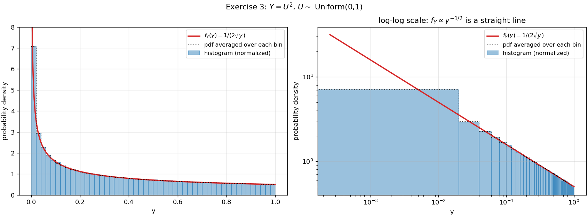
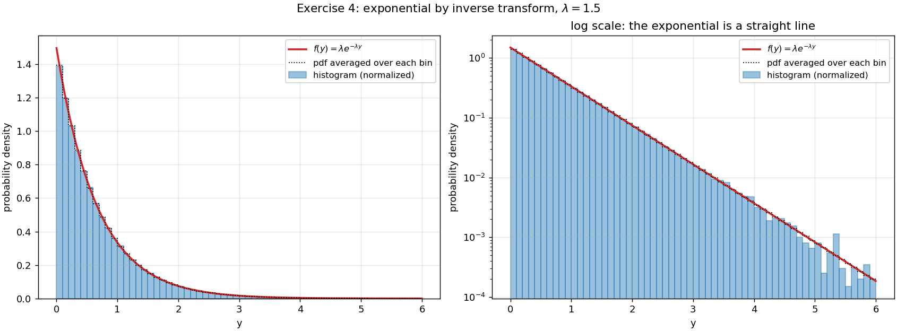

# HomeWork 07: Random numbers

## The assignment

1. **Coin tosses and LLN**: Generate 100,000 fair coin tosses. Print the running fraction of heads and comment on the
   convergence to 0.5.
2. **Monte Carlo estimate of $\pi$**: Use two RNG streams to estimate $\pi$ for several sample sizes. Study how the error decreases
   as $N$ increases.
3. **Change of variables: $Y = U^2$**: Generate $U \sim \mathrm{Uniform}(0,1)$, transform to $Y = U^2$, and compare the histogram
   with the analytic density $f_Y(y) = 1/(2\sqrt{y})$.
4. **Inverse transform exponential**: Use the formula $Y = -\ln(1-U)/\lambda$ with $\lambda = 1.5$ to generate an exponential
   variable. Compare histogram and PDF.
5. **Empirical CDF**: For the exponential sample from Exercise 4, draw the empirical CDF and compare it to the
   exact CDF.

## The solution

| File | Content |
|---|---|
| `common.h`, `common.c` | The random number generator (the notebook's LCG), argument parsing, output files |
| `coin_tosses.c` | 1. Coin tosses and the law of large numbers |
| `monte_carlo_pi.c` | 2. Monte Carlo estimate of $\pi$ with two RNG streams |
| `square_uniform.c` | 3. Change of variables $Y = U^2$ |
| `exponential.c`, `exponential.h` | 4. Exponential distribution by inverse transform |
| `empirical_cdf.c` | 5. Empirical CDF of the sample of exercise 4 |
| `plot_random.py` | Figures in `plots/` |
| `Makefile` | `make` (builds and prints the instructions), `make run`, `make plot`, `make help`, `make clean` |

## Build and run

```bash
make            # builds the programs and prints how to use them
make run        # runs all of them (CSV files in output/)
make plot       # runs them and draws plots/*.png
```

Every program takes optional arguments (sample size etc.), followed by the seed(s). For
example, `./coin_tosses 1e6 42` does 10⁶ tosses with seed 42.

---

## 1. Coin tosses and the law of large numbers

100 000 tosses with the random number generator (RNG) of the lecture notebook, a linear
congruential generator (LCG), with seed 123456789. As in the notebook, the toss is **heads if
$u < 0.5$**. Running fraction of heads $f_n$:

| $n$ | Heads | $f_n$ | $\lvert f_n - 0.5 \rvert$ | In units of $\sigma_n$ |
|---|---|---|---|---|
| 10 | 6 | 0.600000 | 0.100 | 0.63 |
| 100 | 56 | 0.560000 | 0.060 | 1.20 |
| 1 000 | 511 | 0.511000 | 0.011 | 0.70 |
| 10 000 | 5 130 | 0.513000 | 0.013 | 2.60 |
| 100 000 | 50 101 | 0.501010 | 0.0010 | 0.64 |


**Comment.** $f_n$ converges to 0.5, as the **law of large numbers** says, but **slowly and
irregularly**: it last drops below 0.5 at $n = 1503$, then stays above 0.5 for the rest of the
run. At the end of the run, $n = 100\,000$, $f_n = 0.50101$ is within one standard deviation
of 0.5:

$$\sigma_n = \sqrt{\frac{p(1-p)}{n}} = \frac{1}{2\sqrt{n}} \approx 0.0016.$$

## 2. Monte Carlo estimate of $\pi$ with two RNG streams

Points $(x, y)$ uniform in the unit square. The fraction falling inside the quarter circle
$x^2 + y^2 \le 1$ estimates its area $\pi/4$.

**Two streams.** As in the notebook, $x$ and $y$ come from **two RNG streams**: the same generator (the LCG)
started from two different seeds, 123 for the $x$ coordinates and 987654321 for the $y$
coordinates.

**Error.** The estimate after $n$ points is

$$\pi_n = \frac{4\cdot(\text{points inside})}{n}.$$

Each point is inside with probability $p = \pi/4$, so the expected error of $\pi_n$ is

$$\sigma = \sqrt{\frac{\pi(4-\pi)}{n}} \approx \frac{1.64}{\sqrt{n}}.$$

The absolute error $\lvert \pi_n - \pi \rvert$ is compared with $\sigma$: the plot shows this
error at ~1260 values of $n$ between 1 and 10⁷, evenly spaced on a log scale; the table shows it
at the powers of 10:

| $n$ | $\pi_n$ | $\lvert \pi_n - \pi \rvert$ | $\sigma$ theory |
|---|---|---|---|
| 10 | 4.0000000 | 8.6·10⁻¹ | 5.2·10⁻¹ |
| 10² | 3.0400000 | 1.0·10⁻¹ | 1.6·10⁻¹ |
| 10³ | 3.1160000 | 2.6·10⁻² | 5.2·10⁻² |
| 10⁴ | 3.1384000 | 3.2·10⁻³ | 1.6·10⁻² |
| 10⁵ | 3.1380000 | 3.6·10⁻³ | 5.2·10⁻³ |
| 10⁶ | 3.1417880 | 1.9·10⁻⁴ | 1.6·10⁻³ |
| 10⁷ | 3.1412232 | 3.7·10⁻⁴ | 5.2·10⁻⁴ |


**Comment.**
- **The error decreases like $1/\sqrt{n}$.** Over seven orders of magnitude of $n$ the error
  follows the line $\sigma \approx 1.64/\sqrt{n}$, staying around or below it: every extra correct digit costs 100× more
  points, and 10⁷ points give only ~3 correct decimals.
- **The error of a single run fluctuates.** $\sigma$ is only the typical size of the error. The
  deep downward spikes are the moments when $\pi_n$ crosses $\pi$ and the error passes through
  zero, and the error does not always decrease: from $n$ = 10⁶ to 10⁷ it grows from 1.9·10⁻⁴ to
  3.7·10⁻⁴, still within one $\sigma$.

## 3. Change of variables: $Y = U^2$

For $y \in (0, 1)$ the CDF of $Y$ is

$$F_Y(y) = P(U^2 \le y) = P(U \le \sqrt{y}) = \sqrt{y},$$

so the density is

$$f_Y(y) = F_Y'(y) = \frac{1}{2\sqrt{y}},$$

which is the formula $f_Y(y) = f_U(\sqrt{y}) \left\lvert \dfrac{d\sqrt{y}}{dy} \right\rvert$ of the notebook.

It diverges at $y = 0$ but is integrable. $n = 200\,000$ samples (seed 13579), 50 bins on $[0, 1)$.



**Comment.**
- **Agreement.** The histogram follows $1/(2\sqrt{y})$. The log-log panel shows the power law
  $y^{-1/2}$ as a straight line.
- **The first bin.** Its height (7.07) is far from $f_Y$ at the bin centre ($f_Y(0.01) = 5.0$),
  because the density changes a lot inside the bin. The correct comparison is with the
  *average* density over the bin $[a, b)$, $(\sqrt{b} - \sqrt{a})/(b - a) = 7.07$ for $[0, 0.02)$
  (dotted line).

## 4. Exponential distribution by inverse transform

**Inverse transform.** If $F$ is a continuous CDF and $U \sim \mathrm{Uniform}(0,1)$, then
$Y = F^{-1}(U)$ has CDF $F$, because

$$P(F^{-1}(U) \le y) = P(U \le F(y)) = F(y).$$

For the exponential, $F(y) = 1 - e^{-\lambda y}$, so

$$Y = -\frac{\ln(1 - U)}{\lambda}, \qquad \lambda = 1.5.$$

- **No $\ln 0$.** $U \in [0, 1)$, so $1 - U \in (0, 1]$ and the logarithm is never $\ln 0$.
- **A largest value.** The LCG has only $2^{32}$ possible values of $U$, so $Y$ can't exceed
  $32 \ln 2/\lambda \approx 14.8$. That doesn't matter in practice ($P(Y > 14.8) \approx 2\cdot 10^{-10}$),
  but the tail of any distribution generated this way is truncated by the resolution of $U$.

$n = 200\,000$ samples (seed 246813579, as in the notebook), 60 bins on $[0, 6)$; only 26 values
are $\ge 6$ (outside the histogram).



**Comment.**
- **Agreement.** The histogram agrees with $\lambda e^{-\lambda y}$. On the log scale the
  exponential is a straight line of slope $-\lambda$, and the agreement holds down to densities
  of ~10⁻³. Further out, the bins have only a few entries, and Poisson fluctuations
  ($\pm\sqrt{\text{count}}$) become visible.

## 5. Empirical CDF

The program uses the **same sample** as exercise 4 (same LCG, seed and $n$). The empirical CDF

$$F_n(y) = \frac{\text{number of samples} \le y}{n}$$

is computed by sorting the sample: it is a step function jumping by $1/n$ at every value.

It is compared with the exact CDF $F(y) = 1 - e^{-\lambda y}$:

| $y$ | $F_n(y)$ | $F(y)$ |
|---|---|---|
| 0.1 | 0.138630 | 0.139292 |
| 0.5 | 0.525365 | 0.527633 |
| 1.0 | 0.775305 | 0.776870 |
| 2.0 | 0.949780 | 0.950213 |
| 3.0 | 0.988810 | 0.988891 |


**Comment.**
- **Left:** with 200 000 points the empirical and exact CDFs are indistinguishable.
- **Right:** the difference $F_n(y) - F(y)$ is at most 2.5·10⁻³ (at $y \approx 0.54$): the empirical CDF
  agrees with the exact one to about three decimals, as expected for a sample of this size.
- **Why the empirical CDF is useful:** unlike a histogram, it needs no choice of bins.
