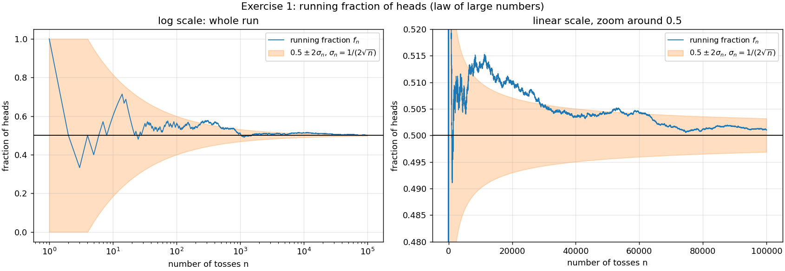
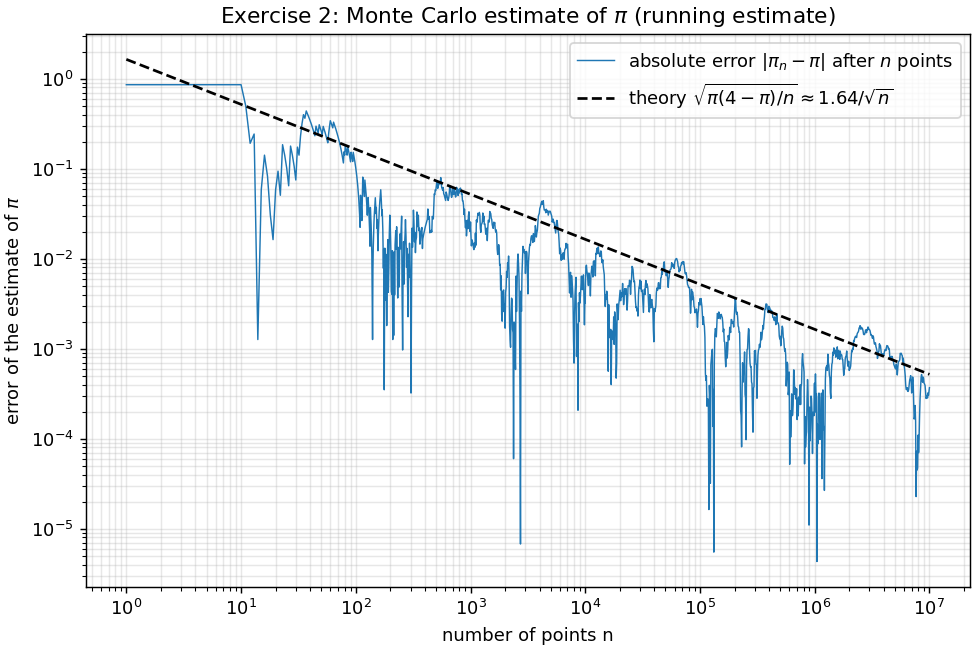
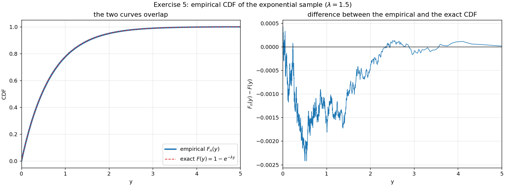

# HomeWork 07: Random numbers

## The assignment

1. **Coin tosses and LLN**
   Generate 100,000 fair coin tosses. Print the running fraction of heads and comment on the
   convergence to 0.5.
2. **Monte Carlo estimate of $\pi$**
   Use two RNG streams to estimate $\pi$ for several sample sizes. Study how the error decreases
   as $N$ increases.
3. **Change of variables: $Y = U^2$**
   Generate $U \sim \mathrm{Uniform}(0,1)$, transform to $Y = U^2$, and compare the histogram
   with the analytic density $f_Y(y) = 1/(2\sqrt{y})$.
4. **Inverse transform exponential**
   Use the formula $Y = -\ln(1-U)/\lambda$ with $\lambda = 1.5$ to generate an exponential
   variable. Compare histogram and PDF.
5. **Empirical CDF**
   For the exponential sample from Exercise 4, draw the empirical CDF and compare it to the
   exact CDF.

## The solution

The five exercises are solved following the lecture notebook
`random_number_generators_intro.ipynb`. The generators and exercises are written in C, and the
plots are made in Python with Matplotlib.

**The generator.** As the notebook requires, the **only random source is the notebook's linear
congruential generator (LCG)**:

  x<sub>n+1</sub> = (1664525·x<sub>n</sub> + 1013904223) mod 2³²,  u<sub>n</sub> = x<sub>n</sub>/2³² ∈ [0, 1)

- **Period.** In C, `uint32_t` arithmetic wraps around modulo 2³² by itself. The period is the
  full 2³² ≈ 4.3·10⁹, because c is odd and a − 1 is a multiple of 4 (Hull–Dobell theorem).
- **Seeds.** The default seeds are the notebook's, so every result below is exactly
  reproducible.

**Main results:**
- The fraction of heads converges to 0.5, slowly: its distance from 0.5 shrinks like 1/(2√n).
- The Monte Carlo error on π decreases like N^−0.500.
- The histograms of U² and of the exponential sample agree with the analytic densities
  1/(2√y) and λe^(−λy).
- The empirical CDF of the exponential sample agrees with the exact CDF 1 − e^(−λy) to within
  2.5·10⁻³.

| File | Content |
|---|---|
| `common.h`, `common.c` | The LCG, argument parsing, output files |
| `coin_tosses.c` | 1. Coin tosses and the law of large numbers |
| `monte_carlo_pi.c` | 2. Monte Carlo estimate of π with two LCG streams |
| `square_uniform.c` | 3. Change of variables Y = U² |
| `exponential.c`, `exponential.h` | 4. Exponential distribution by inverse transform |
| `empirical_cdf.c` | 5. Empirical CDF of the sample of exercise 4 |
| `plot_random.py` | Figures in `plots/` |
| `Makefile` | `make` (builds and prints the instructions), `make run`, `make plot`, `make help`, `make clean` |

## Build and run

```bash
make            # builds the programs and prints how to use them
make run        # runs all of them (CSV files in output/)
make plot       # runs them and draws plots/*.png
```

Every program takes optional arguments (sample size etc.), followed by the seed(s). For
example, `./coin_tosses 1e6 42` does 10⁶ tosses with seed 42.

---

## 1. Coin tosses and the law of large numbers

100 000 tosses with the LCG (seed 123456789). As in the notebook, the toss is **heads if
u < 0.5**. Running fraction of heads fₙ:

| n | Heads | fₙ | \|fₙ − 0.5\| | In units of σₙ |
|---|---|---|---|---|
| 10 | 6 | 0.600000 | 0.100 | 0.63 |
| 100 | 56 | 0.560000 | 0.060 | 1.20 |
| 1 000 | 511 | 0.511000 | 0.011 | 0.70 |
| 10 000 | 5 130 | 0.513000 | 0.013 | 2.60 |
| 100 000 | 50 101 | 0.501010 | 0.0010 | 0.64 |



**Comment.**
- **Convergence.** fₙ converges to 0.5, as the **law of large numbers** says. But it
  converges **slowly and irregularly**: it last drops below 0.5 at n = 1503, then stays above
  0.5 for the rest of the run, and is still at 0.513 after 10 000 tosses.
- **How fast.** The typical distance from 0.5 is the standard deviation of fₙ:
  σₙ = √(p(1−p)/n) = 1/(2√n). It shrinks only like **1/√n**: 100× more tosses make the error
  just 10× smaller.
- **The 2.6σ at n = 10 000 is a normal fluctuation.** fₙ behaves like a random walk: once it
  moves away from 0.5 it stays away for a while, because consecutive values share almost all
  their tosses. By n = 100 000 it is back within 0.64σ of 0.5.

## 2. Monte Carlo estimate of π with two LCG streams

Points (x, y) uniform in the unit square. The fraction falling inside the quarter circle
x² + y² ≤ 1 estimates its area π/4, so π_N = 4·(points inside)/N.

**Two streams.** As in the notebook, x and y come from **two LCG streams**: the same generator
started from two different seeds, 123 for the x coordinates and 987654321 for the y
coordinates.

**Error.** Each point is "inside" with probability p = π/4, so the theoretical error is
σ = √(π(4−π)/N) ≈ 1.64/√N. Every N is repeated R = 20 times (the streams simply continue) to
measure the RMS error:

| N | π (1st run) | Error | RMS error (20 runs) | σ theory |
|---|---|---|---|---|
| 10 | 4.0000000 | 8.6·10⁻¹ | 5.5·10⁻¹ | 5.2·10⁻¹ |
| 10² | 3.2000000 | 5.8·10⁻² | 1.4·10⁻¹ | 1.6·10⁻¹ |
| 10³ | 3.1600000 | 1.8·10⁻² | 5.8·10⁻² | 5.2·10⁻² |
| 10⁴ | 3.1412000 | −3.9·10⁻⁴ | 1.9·10⁻² | 1.6·10⁻² |
| 10⁵ | 3.1482000 | 6.6·10⁻³ | 5.1·10⁻³ | 5.2·10⁻³ |
| 10⁶ | 3.1433960 | 1.8·10⁻³ | 1.7·10⁻³ | 1.6·10⁻³ |
| 10⁷ | 3.1419312 | 3.4·10⁻⁴ | 5.0·10⁻⁴ | 5.2·10⁻⁴ |

**Fitted slope:** RMS error ∝ N^b with **b = −0.500** (theory −0.5).



**Comment.**
- **The error decreases like 1/√N.** Every extra correct digit costs 100× more points, and
  10⁷ points give only ~3 correct decimals. The 1/√N law doesn't depend on the dimension of
  the integral, which is why Monte Carlo wins for high-dimensional integrals.
- **A single run is not a measure of the error.** At N = 10⁴, the first run (3.1412, error
  3.9·10⁻⁴) is 50× more accurate than the typical error at that N (1.9·10⁻²), almost as
  accurate as 10⁷ points. It was lucky. Only the RMS over many runs follows the 1/√N law.

## 3. Change of variables: Y = U²

For y ∈ (0, 1):
- the CDF is F_Y(y) = P(U² ≤ y) = P(U ≤ √y) = **√y**;
- so the density is f_Y(y) = **1/(2√y)**, the formula f_Y(y) = f_U(√y)·|d√y/dy| of the notebook.

It diverges at y = 0 but is integrable. n = 200 000 samples (seed 13579), 50 bins on [0, 1).


**Comment.**
- **Agreement.** The histogram follows 1/(2√y). The log-log panel shows the power law
  y<sup>−1/2</sup> as a straight line.
- **The first bin.** Its height (7.07) is far from f_Y at the bin centre (f_Y(0.01) = 5.0),
  because the density changes a lot inside the bin. The correct comparison is with the
  *average* density over the bin, (√b − √a)/(b − a) = 7.07 for [0, 0.02) (dotted line).

## 4. Exponential distribution by inverse transform

**Inverse transform.** If F is a continuous CDF and U ~ Uniform(0,1), then Y = F⁻¹(U) has CDF
F, because P(F⁻¹(U) ≤ y) = P(U ≤ F(y)) = F(y). For the exponential, F(y) = 1 − e^(−λy), so

  **Y = −ln(1 − U)/λ**, with λ = 1.5.

- **No ln(0).** U ∈ [0, 1), so 1 − U ∈ (0, 1] and the logarithm is never ln 0.
- **A largest value.** The LCG has only 2³² possible values of U, so Y can't exceed
  32 ln 2/λ ≈ 14.8. That doesn't matter in practice (P(Y > 14.8) ≈ 2·10⁻¹⁰), but the tail of
  any distribution generated this way is truncated by the resolution of U.

n = 200 000 samples (seed 246813579, as in the notebook), 60 bins on [0, 6); only 26 values
are ≥ 6 (outside the histogram).


**Comment.**
- **Agreement.** The histogram agrees with λe^(−λy). On the log scale the exponential is a
  straight line of slope −λ, and the agreement holds down to densities of ~10⁻³. Further out,
  the bins have only a few entries, and Poisson fluctuations (±√count) become visible.

## 5. Empirical CDF

The program uses the **same sample** as exercise 4 (same LCG, seed and n). The empirical CDF
Fₙ(y) = (number of samples ≤ y)/n is computed by sorting the sample: it is a step function
jumping by 1/n at every value.

It is compared with the exact CDF F(y) = 1 − e^(−λy):

| y | Fₙ(y) | F(y) |
|---|---|---|
| 0.1 | 0.138630 | 0.139292 |
| 0.5 | 0.525365 | 0.527633 |
| 1.0 | 0.775305 | 0.776870 |
| 2.0 | 0.949780 | 0.950213 |
| 3.0 | 0.988810 | 0.988891 |



**Comment.**
- **Left:** with 200 000 points the empirical and exact CDFs are indistinguishable.
- **Right:** the difference Fₙ(y) − F(y) is at most 2.5·10⁻³ (at y ≈ 0.54): the empirical CDF
  agrees with the exact one to about three decimals, as expected for a sample of this size.
- **Why the empirical CDF is useful:** unlike a histogram, it needs no choice of bins.
