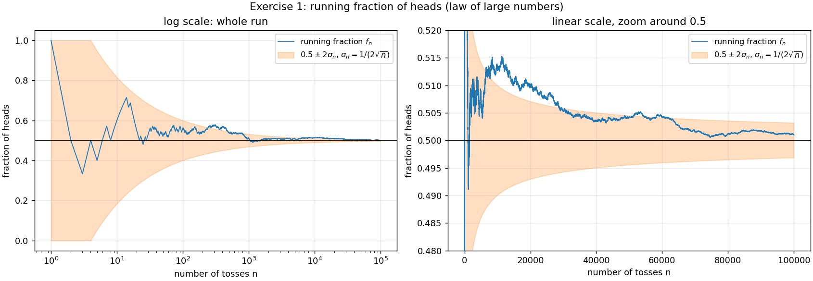
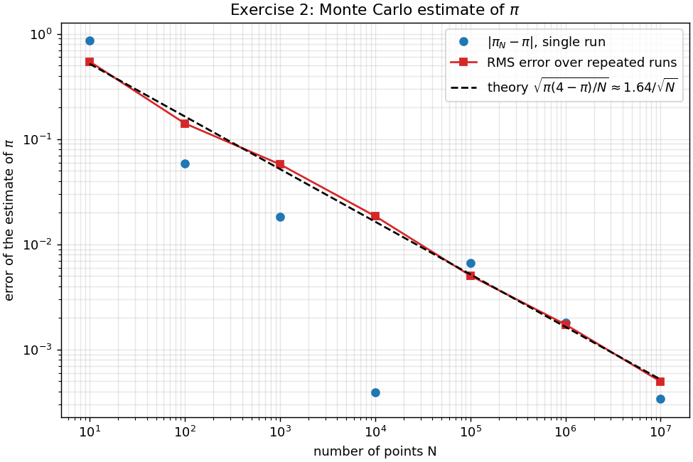
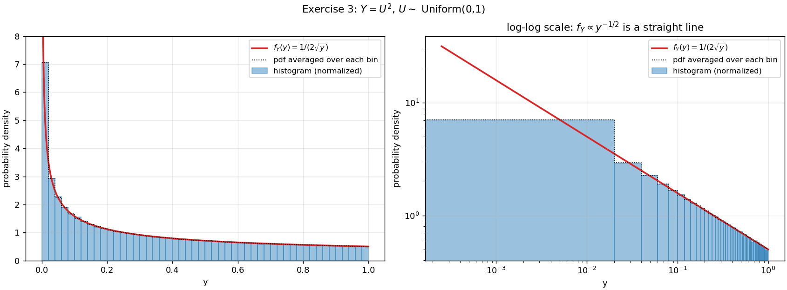
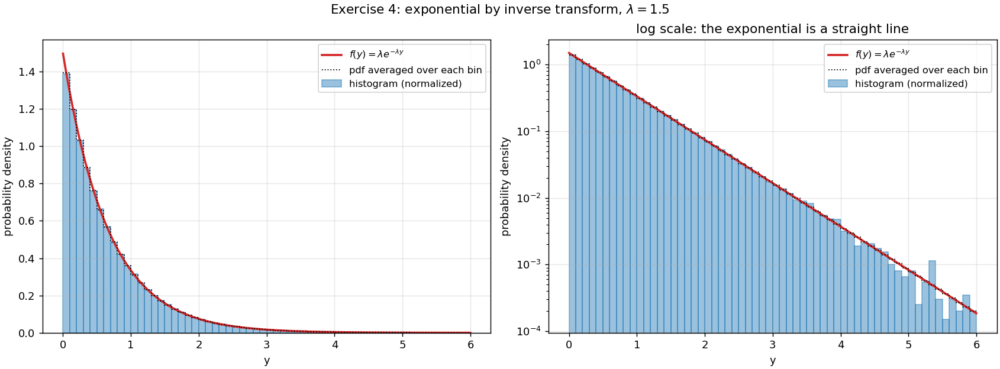
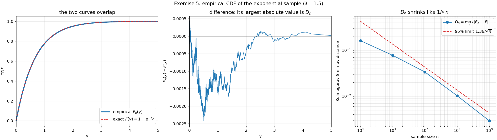
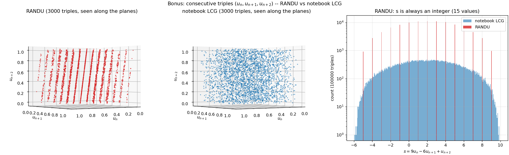

# Random numbers: law of large numbers, Monte Carlo, transformations

Five exercises, plus a bonus on RANDU, from the lecture notebook
`random_number_generators_intro.ipynb`. The generators and exercises are written in C, and the
plots are made in Python with Matplotlib.

**The generator.** As the notebook requires, the **only random source is the notebook's linear
congruential generator (LCG)**:

  x<sub>n+1</sub> = (1664525·x<sub>n</sub> + 1013904223) mod 2³²,  u<sub>n</sub> = x<sub>n</sub>/2³² ∈ [0, 1)

- **Period.** In C, `uint32_t` arithmetic wraps around modulo 2³² by itself. The period is the
  full 2³² ≈ 4.3·10⁹, because c is odd and a − 1 is a multiple of 4 (Hull–Dobell theorem).
- **Seeds.** The default seeds are the notebook's, so every result below is exactly
  reproducible. GSL is used only for the χ² p-values and for sorting.

| File | Content |
|---|---|
| `common.h`, `common.c` | The LCG (and RANDU), argument parsing, output files, χ² test |
| `coin_tosses.c` | 1. Coin tosses and the law of large numbers |
| `monte_carlo_pi.c` | 2. Monte Carlo estimate of π with two LCG streams |
| `square_uniform.c` | 3. Change of variables Y = U² |
| `exponential.c`, `exponential.h` | 4. Exponential distribution by inverse transform |
| `empirical_cdf.c` | 5. Empirical CDF of the sample of exercise 4 |
| `randu_planes.c` | Bonus: RANDU's triples lie on 15 planes |
| `plot_random.py` | Figures in `plots/` |
| `Makefile` | `make` (builds and prints the instructions), `make run`, `make plot`, `make help`, `make clean` |

## Build and run

```bash
make            # builds the programs and prints how to use them
make run        # runs all of them (CSV files in output/)
make plot       # runs them and draws plots/*.png
```

Every program takes optional arguments (sample size etc.), followed by the seed(s). For
example, `./coin_tosses 1e6 42` does 10⁶ tosses with seed 42.

---

## 1. Coin tosses and the law of large numbers

100 000 tosses with the LCG (seed 123456789). As in the notebook, the toss is **heads if
u < 0.5**. Running fraction of heads fₙ:

| n | Heads | fₙ | \|fₙ − 0.5\| | In units of σₙ | Lowest-bit "coin" |
|---|---|---|---|---|---|
| 10 | 6 | 0.600000 | 0.100 | 0.63 | 0.500000 |
| 100 | 56 | 0.560000 | 0.060 | 1.20 | 0.500000 |
| 1 000 | 511 | 0.511000 | 0.011 | 0.70 | 0.500000 |
| 10 000 | 5 130 | 0.513000 | 0.013 | 2.60 | 0.500000 |
| 100 000 | 50 101 | 0.501010 | 0.0010 | 0.64 | 0.500000 |



**Comment.**
- **Convergence.** fₙ converges to 0.5, as the **law of large numbers** says. But it
  converges **slowly and irregularly**: it last drops below 0.5 at n = 1503, then stays above
  0.5 for the rest of the run, and is still at 0.513 after 10 000 tosses.
- **How fast.** The typical distance from 0.5 is the standard deviation of fₙ:
  σₙ = √(p(1−p)/n) = 1/(2√n). It shrinks only like **1/√n**: 100× more tosses make the error
  just 10× smaller.
- **The 2.6σ at n = 10 000 is a normal fluctuation, not a defect of the generator.** Repeating
  the experiment with 2000 different seeds gives deviations at n = 10 000 with mean −0.02σ and
  spread 0.96σ (a perfect generator gives 0 and 1), and |z| > 2.6 in 0.55% of the runs.
  Moreover, fₙ is a random walk: once it moves away from 0.5, it stays away for a long time,
  because consecutive values share almost all their tosses.
- **The low-bit trap.** The last column uses the *lowest* bit of the LCG state as the coin,
  instead of u < 0.5, which is the *highest* bit. It gives exactly 0.500000 every time, because
  in an LCG modulo 2³² the lowest bit simply alternates: `0101010101010101…`. A result that is
  "too perfect" is a warning sign. **Never use the low bits of an LCG** (e.g. `x % 2` or
  `x % 6` for a die).

## 2. Monte Carlo estimate of π with two LCG streams

Points (x, y) uniform in the unit square. The fraction falling inside the quarter circle
x² + y² ≤ 1 estimates its area π/4, so π_N = 4·(points inside)/N.

**Two streams.** As in the notebook, x and y come from **two LCG streams**: the same generator
started from seed 123 for x and seed 987654321 for y.

**Error.** Each point is "inside" with probability p = π/4, so the theoretical error is
σ = √(π(4−π)/N) ≈ 1.64/√N. Every N is repeated R = 20 times (the streams simply continue) to
measure the RMS error:

| N | π (1st run) | Error | RMS error (20 runs) | σ theory |
|---|---|---|---|---|
| 10 | 4.0000000 | 8.6·10⁻¹ | 5.5·10⁻¹ | 5.2·10⁻¹ |
| 10² | 3.2000000 | 5.8·10⁻² | 1.4·10⁻¹ | 1.6·10⁻¹ |
| 10³ | 3.1600000 | 1.8·10⁻² | 5.8·10⁻² | 5.2·10⁻² |
| 10⁴ | 3.1412000 | −3.9·10⁻⁴ | 1.9·10⁻² | 1.6·10⁻² |
| 10⁵ | 3.1482000 | 6.6·10⁻³ | 5.1·10⁻³ | 5.2·10⁻³ |
| 10⁶ | 3.1433960 | 1.8·10⁻³ | 1.7·10⁻³ | 1.6·10⁻³ |
| 10⁷ | 3.1419312 | 3.4·10⁻⁴ | 5.0·10⁻⁴ | 5.2·10⁻⁴ |

**Fitted slope:** RMS error ∝ N^b with **b = −0.500** (theory −0.5).



**Comment.**
- **The error decreases like 1/√N.** Every extra correct digit costs 100× more points, and
  10⁷ points give only ~3 correct decimals. The 1/√N law doesn't depend on the dimension of
  the integral, which is why Monte Carlo wins for high-dimensional integrals.
- **A single run is not a measure of the error.** At N = 10⁴, the first run (3.1412, error
  3.9·10⁻⁴) is 50× more accurate than the typical error at that N (1.9·10⁻²), almost as
  accurate as 10⁷ points. It was lucky. Only the RMS over many runs follows the 1/√N law.
- **Are the two streams really independent?** Not entirely. There is only *one* sequence of
  2³² numbers, and two seeds are two starting points on the same cycle. Walking around the
  cycle shows that seed 987654321 comes **1 705 900 686 steps** after seed 123.
  - This run uses about 2.2·10⁸ numbers per stream (20 × (10 + 100 + … + 10⁷)), far fewer, so
    the streams never overlap.
  - `./monte_carlo_pi 1e8` would use 2.2·10⁹ numbers per stream: the x stream would reach the
    starting point of the y stream, and the two coordinates would then be the *same* numbers.
  - The 32-bit period (4.3·10⁹) is small for modern Monte Carlo. That is one reason modern
    generators have much longer periods (Mersenne Twister: 2¹⁹⁹³⁷ − 1) and proper ways to
    create independent streams ("jump-ahead").

## 3. Change of variables: Y = U²

For y ∈ (0, 1):
- the CDF is F_Y(y) = P(U² ≤ y) = P(U ≤ √y) = **√y**;
- so the density is f_Y(y) = **1/(2√y)**, the formula f_Y(y) = f_U(√y)·|d√y/dy| of the notebook.

It diverges at y = 0 but is integrable. n = 200 000 samples (seed 13579), 50 bins:

| | Sample | Exact |
|---|---|---|
| Mean E[Y] = 1/3 | 0.332980 | 0.333333 |
| Variance Var[Y] = 1/5 − 1/9 = 4/45 | 0.088734 | 0.088889 |
| χ² (49 degrees of freedom) | 42.1, p-value = 0.75 | |



**Comment.**
- **Agreement.** The histogram follows 1/(2√y). The log-log panel shows the power law
  y<sup>−1/2</sup> as a straight line.
- **The first bin.** Its height (7.07) is far from f_Y at the bin centre (f_Y(0.01) = 5.0),
  because the density changes a lot inside the bin. The correct comparison is with the
  *average* density over the bin, (√b − √a)/(b − a) = 7.07 for [0, 0.02) (dotted line).
- **The χ² test** compares observed and expected counts nᵢ = n(√bᵢ − √aᵢ) in all bins. A value
  close to the number of degrees of freedom (p = 0.75) means the histogram is consistent with
  f_Y.

## 4. Exponential distribution by inverse transform

**Inverse transform.** If F is a continuous CDF and U ~ Uniform(0,1), then Y = F⁻¹(U) has CDF
F, because P(F⁻¹(U) ≤ y) = P(U ≤ F(y)) = F(y). For the exponential, F(y) = 1 − e^(−λy), so

  **Y = −ln(1 − U)/λ**, with λ = 1.5.

- **No ln(0).** U ∈ [0, 1), so 1 − U ∈ (0, 1] and the logarithm is never ln 0.
- **A largest value.** The LCG has only 2³² possible values of U, so Y can't exceed
  32 ln 2/λ ≈ 14.8. That doesn't matter in practice (P(Y > 14.8) ≈ 2·10⁻¹⁰), but the tail of
  any distribution generated this way is truncated by the resolution of U.

n = 200 000 samples (seed 246813579, as in the notebook), 60 bins on [0, 6), plus an overflow
bin y ≥ 6:

| | Sample | Exact |
|---|---|---|
| Mean 1/λ | 0.66898 | 0.66667 |
| Variance 1/λ² | 0.44577 | 0.44444 |
| Values ≥ 6 | 26 | 24.7 expected (n·e⁻⁹) |
| χ² (59 degrees of freedom) | 56.9, p-value = 0.55 | |



**Comment.**
- **Agreement.** The histogram agrees with λe^(−λy). On the log scale the exponential is a
  straight line of slope −λ, and the agreement holds down to densities of ~10⁻³. Further out,
  the bins have only a few entries, and Poisson fluctuations (±√count) become visible.
- **The mean is within the expected error.** It differs from 1/λ by 0.0023, while its
  statistical error is σ/√n = 0.667/√200000 = 0.0015, so the difference is 1.5σ.

## 5. Empirical CDF

The program uses the **same sample** as exercise 4 (same LCG, seed and n). The empirical CDF
Fₙ(y) = (number of samples ≤ y)/n is computed by sorting the sample: it is a step function
jumping by 1/n at every value.

**Kolmogorov–Smirnov distance.** The distance between Fₙ and the exact
F(y) = 1 − e^(−λy) is measured by Dₙ = max_y |Fₙ(y) − F(y)|. If the sample really comes from
F, √n·Dₙ follows the Kolmogorov distribution, and **√n·Dₙ < 1.36 with 95% probability**.

| n (first n values) | Dₙ | √n·Dₙ |
|---|---|---|
| 10 | 0.162 | 0.51 |
| 100 | 0.078 | 0.78 |
| 1 000 | 0.034 | 1.07 |
| 10 000 | 0.0103 | 1.03 |
| 100 000 | 0.0029 | 0.92 |
| 200 000 (all) | 0.0025 | 1.10 |



**Comment.**
- **Left:** with 200 000 points the empirical and exact CDFs are indistinguishable.
- **Centre:** the difference is at most 2.5·10⁻³ (at y ≈ 0.54).
- **Right:** Dₙ shrinks like 1/√n, the same √n law as in exercises 1 and 2. √n·Dₙ stays below
  the 95% limit 1.36 for every n, so the sample is consistent with the exponential
  distribution.
- **Why the empirical CDF is useful:** unlike a histogram, it needs no choice of bins.

## Bonus: RANDU and why one-dimensional tests are not enough

The notebook's warning example is **RANDU**, x<sub>n+1</sub> = 65539·x<sub>n</sub> mod 2³¹.
Since 65539 = 2¹⁶ + 3, we have 65539² ≡ 6·65539 − 9 (mod 2³¹), so

  x<sub>n+2</sub> ≡ 6x<sub>n+1</sub> − 9x<sub>n</sub> (mod 2³¹)  ⟹  **9u<sub>n</sub> − 6u<sub>n+1</sub> + u<sub>n+2</sub> = an integer**.

Every triple (u<sub>n</sub>, u<sub>n+1</sub>, u<sub>n+2</sub>) lies on one of the parallel
planes 9x − 6y + z = k. Since the left side is between −6 and 10, **only 15 planes** are
used. `./randu_planes` checks it on 10⁶ triples:

| | RANDU | Notebook LCG |
|---|---|---|
| s = 9u<sub>n</sub> − 6u<sub>n+1</sub> + u<sub>n+2</sub> is an integer | always (15 values, −5 … 9) | no |
| Triples with s within 0.01 of an integer (uniform: ~2%) | **100%** | 2.02% |



**Comment.**
- **What the plot shows.** Seen *along* the planes (left), RANDU's 3000 triples collapse onto
  15 lines, while the LCG's triples fill the cube (centre). The histogram of s (right) shows
  the same thing as 15 spikes.
- **RANDU looks fine in one dimension.** Its histogram of u looks flat, so its defect
  only appears when numbers are used in groups, as in any 3D Monte Carlo simulation. A
  generator must be tested in several dimensions, not just with a 1D histogram.
- **The notebook LCG has the same kind of structure.** Every LCG's triples lie on a lattice of
  planes (Marsaglia's theorem), but with a much finer spacing, which this test cannot see.
